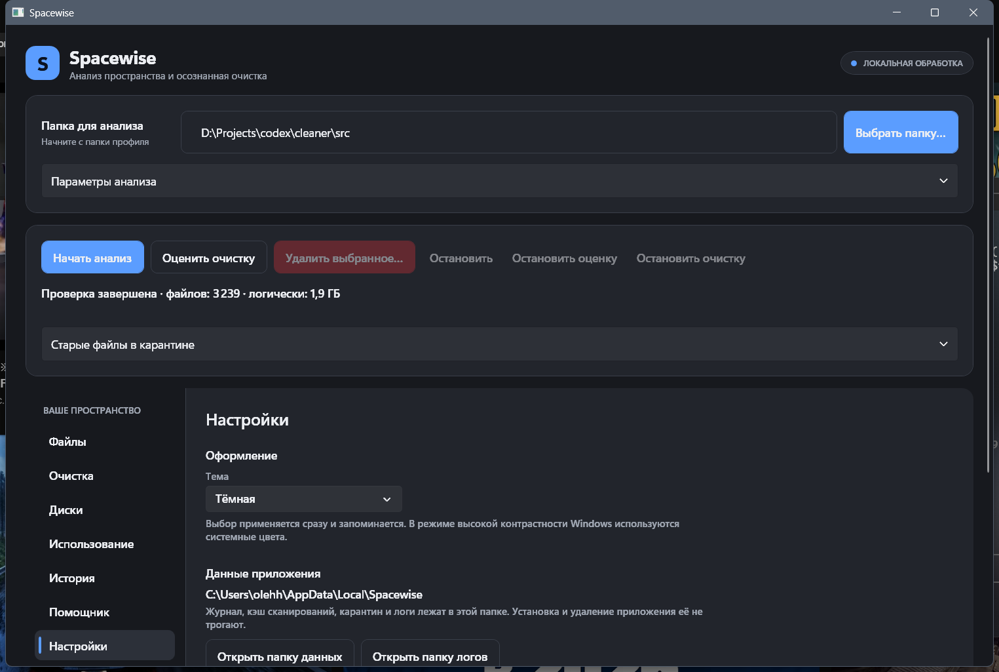

# Spacewise

[](LICENSE)


Настольное приложение для Windows: показывает, чем занят диск, и безопасно освобождает место с понятными последствиями. Всё работает локально, без облака и телеметрии. Когда окно закрыто, процессов Spacewise нет.

<p align="center"></p>

## Возможности

- **Анализ диска:** быстрый обход метаданных, крупнейшие файлы, фактический размер на диске, жёсткие ссылки не завышают выгоду, ссылки и облачные заглушки пропускаются.
- **Каталог очистки:** 57 проверенных правил (кэши браузеров, шейдеров, пакетных менеджеров, IDE, лаунчеров, временные файлы). У каждого правила есть описание последствий и тест на реальных наборах файлов.
- **Цель по месту:** укажите, сколько гигабайт нужно, и Spacewise подберёт безопасные категории. Запущенные, занятые и не до конца проверенные категории исключаются.
- **Освобождение измеряется на томе**, а не суммой размеров найденных файлов. Очистка выполняется только после отдельного подтверждения, журнал решений сохраняется.
- **Диски и прогноз:** история заполнения томов и оценка, когда закончится место.
- **Локальный помощник (необязательно):** Qwen 3.5 2B объясняет категории очистки. Модель загружается по вашему согласию с проверкой SHA-256 и работает в отдельном процессе; путей и файлов она не получает и ничего не удаляет.
- **Светлая и тёмная тема**, настройки, интерфейс на русском.

<p align="center">
  
  
</p>

## Установка

Скачайте `.msi` со страницы [Releases](../../releases/latest) и запустите. Права администратора нужны только установщику; само приложение работает без повышения прав. Установщик не создаёт служб, драйверов и автозапуска.

> Установщик подписан самоподписанным сертификатом, поэтому Windows может показать «Неизвестный издатель» или предупреждение SmartScreen: нажмите «Подробнее → Выполнить в любом случае».

**Важно:** удаление файлов необратимо. Перед очисткой посмотрите оценку последствий. Данные приложения лежат в `%LOCALAPPDATA%\Spacewise` и при удалении программы не затрагиваются.

## Состояние проекта

Рабочий MVP (.NET 10, WPF). Дорожная карта и статус по этапам: [docs/ROADMAP.md](docs/ROADMAP.md). Ещё впереди: расширение каталога до 80+ правил, операции с правами администратора через отдельный broker, подписанный релиз и проверка на чистой VM.

## Документы

| Файл | Что это |
|---|---|
| [docs/ROADMAP.md](docs/ROADMAP.md) | Дорожная карта с галочками выполненных шагов |
| [docs/spec/ТЗ Spacewise.md](docs/spec/ТЗ%20Spacewise.md) | Техническое задание |
| [docs/spec/Решения и сравнение подходов.md](docs/spec/Решения%20и%20сравнение%20подходов.md) | Итоговые решения и сравнение подходов |
| [docs/adr/](docs/adr) | Архитектурные решения по итогам spike-ов |

## Сборка и проверка

Windows x64, .NET SDK 10 (версия закреплена в `global.json`). Из корня репозитория:

```powershell
dotnet build Spacewise.slnx -c Release
dotnet test --solution Spacewise.slnx -c Release --no-build
dotnet run --project src/Spacewise.Desktop -c Release --no-build
```

Тесты идут через Microsoft.Testing.Platform (включён в `global.json`). `Spacewise.Tests.Fs` по умолчанию создаёт фикстуры в `%TEMP%`. Чтобы гонять их на отдельном томе NTFS, смонтируйте VHDX из PowerShell от имени администратора и укажите корень:

```powershell
tests/Spacewise.Tests.Fs/Mount-NtfsFixture.ps1 -Path D:\fixtures\spacewise.vhdx
$env:SPACEWISE_FS_ROOT = 'X:\'   # буква из вывода скрипта
dotnet test --project tests/Spacewise.Tests.Fs -c Release
tests/Spacewise.Tests.Fs/Mount-NtfsFixture.ps1 -Path D:\fixtures\spacewise.vhdx -Dismount
```

Тесты NTFS (allocated size, FileId, hard link, sparse) пропускаются, если том фикстур не NTFS.

## Структура

```text
Spacewise.slnx, global.json, Directory.Build.props, Directory.Packages.props
src/Spacewise.Core/          контракты, запрещающая политика, защищённые пути, IScanService, форматирование; без Win32
src/Spacewise.Catalog/       встроенный каталог правил очистки, загрузчик с проверкой, glob, preview без удаления
src/Spacewise.Data/          SQLite3MC: cache.db/journal.db, миграции с бэкапом, единый writer, ScanStore
src/Spacewise.Platform.Windows/  сканер метаданных, P/Invoke (allocated size, FileId, links), ключ БД под DPAPI, Restart Manager
src/Spacewise.Inference.Contracts/  установка закреплённой модели и проверка ответов без зависимости от runtime
src/Spacewise.Inference/     отдельный CPU-процесс LLamaSharp; веса модели загружаются отдельно
src/Spacewise.Desktop/       окно WPF: анализ, очистка и помощник, Generic Host, MVVM
tests/Spacewise.Tests.Unit/  xUnit v3: форматирование, политика и защищённые пути, ScanService, хранилище, каталог и fixture правил, архитектурные правила
tests/Spacewise.Tests.Fs/    xUnit v3: сканер на реальной ФС, NTFS-фикстуры, скрипт VHDX
docs/                        концепция, ТЗ, решения, исследования
```

## История

Тег `baseline-codex` — исходный каркас и ТЗ от Codex. Тег `claude-spec-original` — ТЗ Claude до слияния. Ветка `claude/spec` сохранена.

## Лицензия

MIT, см. [LICENSE](LICENSE). Сторонние компоненты и лицензии: [THIRD-PARTY-NOTICES.md](THIRD-PARTY-NOTICES.md).
