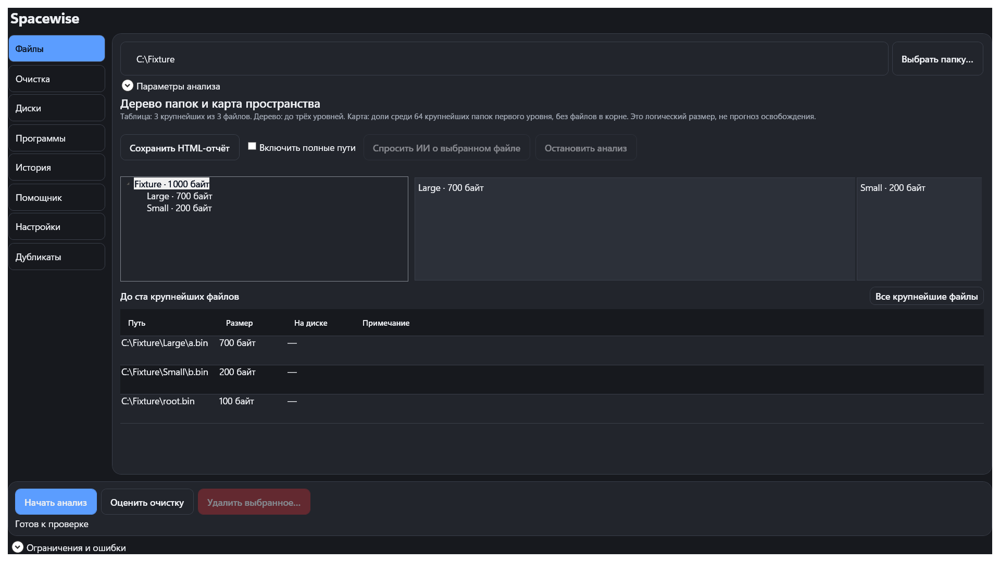
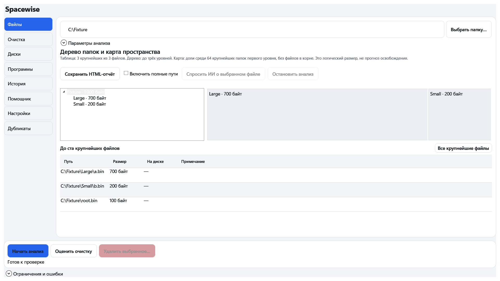
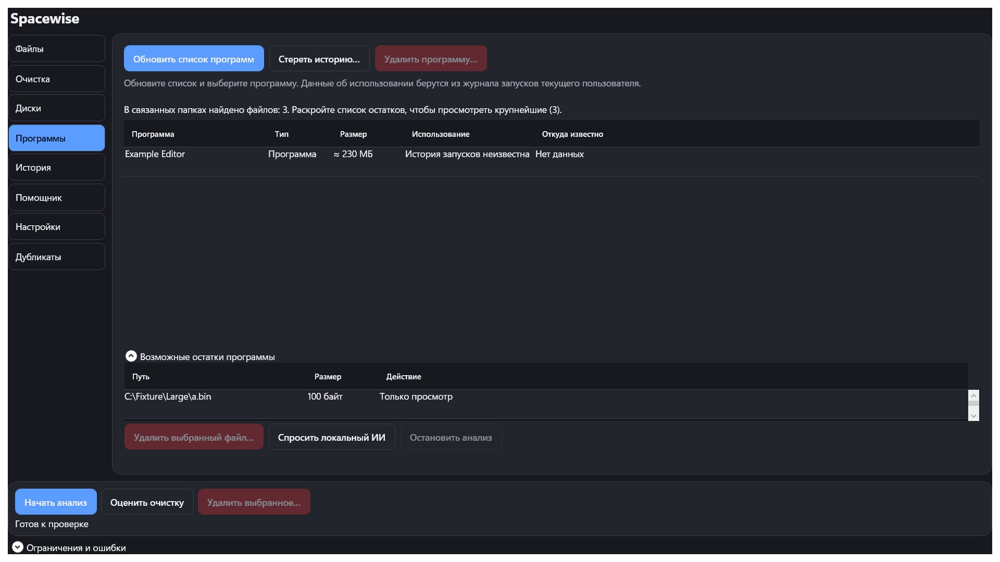

# Spacewise

[](LICENSE)


**Spacewise** — настольное приложение для Windows. Показывает, чем заняты диски, помогает очистить выбранные категории и найти файлы, оставшиеся после удаления программ. Сканирование, очистка и опциональный ИИ работают локально. Телеметрия отсутствует.

<p align="center"></p>

## Скачать

- **Публичная версия 0.3.0** доступна на [GitHub Releases](https://github.com/OlehHavrilko/spacewise/releases/tag/v0.3.0). Это MSI для Windows x64 с самоподписанным сертификатом и опубликованной SHA-256.
- **Windows 0.4.0** доступна в исходниках. Из неё собираются MSI и portable ZIP. В этой версии добавлены деинсталляция, поиск остатков, исключения, дерево папок, дубликаты и подсказки по файлам. Команды сборки приведены ниже.
- **Linux** поставляется отдельной ранней сборкой. Основная разработка сейчас ведётся для Windows. [Инструкция для Linux](docs/LINUX.md)

MSI требует прав администратора для установки. Само приложение запускается с обычными правами и хранит данные в `%LOCALAPPDATA%\Spacewise`. В [portable-режиме](docs/PORTABLE.md) данные находятся в каталоге `Data` рядом с приложением.

## Как пользоваться Windows 0.4.0

1. **Файлы.** Выберите диск или папку и нажмите «Начать анализ». Дерево и карта показывают распределение размера, таблица — до 100 крупнейших файлов. Ссылки и облачные заглушки пропускаются. Полные пути можно отдельно включить при экспорте HTML-отчёта.
2. **Очистка.** Нажмите «Оценить очистку», изучите найденные категории и отметьте нужные. После подтверждения файлы удаляются безвозвратно. В отчёте отдельно показаны логический размер и измеренное изменение свободного места. Встроенный каталог содержит 57 правил. Доступны [свои правила JSON](docs/USER_RULES.md) и постоянные исключения.
3. **Программы.** Обновите список, выберите приложение и запустите штатный деинсталлятор. Поддерживаются MSI и зарегистрированные EXE внутри папки установки. После подтверждённой деинсталляции Spacewise проверяет зарегистрированную папку и точные совпадения `Издатель\Программа` в AppData и ProgramData. Из подтверждённой области поиска в пользовательском AppData можно вручную выбрать отдельный файл для удаления. Остальные находки доступны для просмотра. Папки, связанные с другим установленным приложением, пропускаются.
4. **Помощник.** По желанию подключите локальную модель и запросите пояснение к категории, выбранному файлу или возможным остаткам. Модель получает ограниченные метаданные. Действия с файлами подтверждает пользователь. [Настройка модели](docs/ASSISTANT_PROVIDERS.md)

<p align="center">
  
  
</p>

Скриншоты сделаны с демонстрационными данными. Поиск дубликатов по содержимому, история заполнения томов и тренды папок доступны в отдельных разделах.

## Сборка и проверка

Нужны Windows x64 и .NET SDK из `global.json`. Из корня репозитория выполните:

```powershell
dotnet build Spacewise.slnx -c Release
dotnet test --solution Spacewise.slnx -c Release --no-build --no-restore
dotnet run --project src/Spacewise.Desktop -c Release --no-build
```

Для MSI и portable ZIP:

```powershell
dotnet tool restore
dotnet tool run wix -- extension add -g WixToolset.UI.wixext/5.0.2
./installer/build.ps1 -Version 0.4.0
./installer/build-portable.ps1 -Version 0.4.0
```

Скрипты создают новые каталоги в `artifacts` и печатают SHA-256. Отдельная проверка деинсталляции создаёт и удаляет уникальный MSI для текущего пользователя:

```powershell
./tests/Verify-WindowsUninstall.ps1
```

## Документация

| Раздел | Содержание |
| --- | --- |
| [Состояние и проверки](docs/ROADMAP.md) | Что готово, что проверено и какие сценарии ещё впереди |
| [Portable](docs/PORTABLE.md) | Каталог данных и пароль для ключа базы |
| [Правила очистки](docs/USER_RULES.md) | Формат пользовательского каталога |
| [Локальный ИИ](docs/ASSISTANT_PROVIDERS.md) | Провайдеры, модели и отключение |
| [ТЗ](docs/spec/ТЗ%20Spacewise.md) · [ADR](docs/adr/) | Требования и архитектурные решения |

Код распространяется по [MIT](LICENSE). Лицензии зависимостей описаны в [THIRD-PARTY-NOTICES.md](THIRD-PARTY-NOTICES.md).
