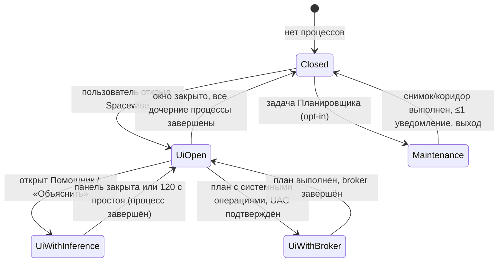

# Spacewise возвращает место и объясняет каждое решение

**Spacewise (рабочее название Cleaner) — настольное приложение для Windows 10/11 на .NET 10 WPF, которое освобождает место, измеренное на томе (свободные байты до и после), а не «найденный мусор», и при этом знает, какими программами человек реально пользуется.** Мощность уровня BleachBit и выше достигается тремя слоями: подписанный декларативный каталог правил для пользовательских и прикладных кэшей; узкий набор системных операций, выполняемых только штатными механизмами Windows (DISM, VSS, powercfg, pnputil, обработчики Disk Cleanup, WOF-сжатие, компактация VHDX) через кратковременный elevated broker; аналитика использования, которая при открытии окна ретроспективно читает то, что Windows уже записала (UserAssist, BAM, Prefetch, SRUM, манифесты лаунчеров), и через USN-журнал NTFS узнаёт, что изменилось с прошлого запуска. Локальный ИИ состоит из детерминированных правил, маленьких калиброванных классификаторов и опциональной локальной LLM в отдельном дочернем процессе. Он работает в режиме «Советник» по умолчанию, а «Автопилот» допускается только внутри коридора, который задаёт пользователь. Модель никогда ничего не исполняет: план проверяет и выполняет детерминированный executor, и каждое решение журналируется с причинами. Когда окно закрыто, в системе нет ни одного процесса Spacewise, кроме разовой задачи Планировщика, если пользователь сам её включил. Документ задаёт требования с приоритетами MVP / v1 / v2, архитектуру, модель данных, правила безопасности, экраны с микрокопией, поставку, тестирование, этапы и критерии приёмки. Факты, которые в исследовании не подтверждены первичным источником, помечены **[не верифицировано]**. Ориентир сроков: MVP за 10–14 недель командой из 2–3 разработчиков, публичная 1.0 ещё через 12–16 недель, 2.0 ещё через 12–20 недель (оценка, не обещание).

## Содержание

1. Статус документа, обозначения и приоритеты
2. Продукт на одной странице: обещание, границы и неизменяемые решения
3. Исходная точка: что на самом деле умеет starter
4. Движок освобождения места
5. Аналитика использования: что используется, а что нет
6. Локальный ИИ: классификаторы, LLM, коридор автопилота
7. Архитектура: процессы, решение, сканер, executor, broker
8. Данные: SQLite-схема, хранение, миграции
9. Безопасность: модель угроз и обязательные запреты
10. Интерфейс: дизайн-система, навигация, все экраны, состояния, микрокопия
11. Поставка: установщик, подпись, обновления, модели
12. Тестирование и ворота качества
13. Этапы разработки
14. Сводные критерии приёмки
15. Риски
16. Открытые вопросы и непроверенные факты
17. Заключение

---

## 1. Статус документа, обозначения и приоритеты

Документ — техническое задание на продукт Spacewise, составленное 23.10.2026 на основе пяти исследовательских заметок этой серии и двух предыдущих отчётов. Он предназначен для передачи разработчику и самодостаточен. Если исследование противоречит ранним документам, приоритет у этого ТЗ. Пример: ранний отчёт предлагал opt-in collector процессов, который работает постоянно. Это противоречит решению владельца о нулевой фоновой нагрузке, поэтому collector заменён ретроспективным чтением артефактов Windows и USN-журнала.

Обозначения. **«Требование»** — обязательное поведение с идентификатором вида `FR-CLN-012` (функциональное) или `NFR-PERF-003` (нефункциональное). **«Решение»** — выбранный путь реализации, его можно пересмотреть через ADR. **[не верифицировано]** — инженерное знание или вывод, который нужно подтвердить spike-ом или тестом до фиксации. Приоритеты: **MVP** — первая подписанная бета без прав администратора; **v1** — публичная 1.0 с broker, аналитикой и советником; **v2** — 2.0 с автопилотом на модельной уверенности, MFT-сканером, SRUM и расширениями.

Префиксы требований: `CLN` — очистка, `SYS` — системные операции, `CMP` — сжатие, `DUP` — дубликаты, `APP` — программы и игры, `OPT` — оптимизация, `USE` — аналитика использования, `AI` — интеллект, `AUTO` — автоматизация, `SEC` — безопасность, `DATA` — данные, `UI` — интерфейс, `DEL` — поставка, `PERF` — производительность.

## 2. Продукт на одной странице: обещание, границы и неизменяемые решения

Обещание продукта из исходной концепции сохраняется дословно: «Покажи, куда уходит место, объясни, что можно убрать, и помоги сделать это с понятными последствиями» ([PROJECT_PROMPT_RU.md](file:///D:/Projects/codex/cleaner/PROJECT_PROMPT_RU.md)). Spacewise добавляет к нему два измеримых обязательства. Первое: каждое заявленное освобождение подтверждается изменением свободного места тома. Второе: каждое «не используется» опирается на названный источник и период наблюдения, а не на возраст файла.

Целевые пользователи — четыре группы из концепции: человек с заканчивающимся местом на C:, владелец нескольких дисков с играми, опытный пользователь, которому нужны контроль и история, и человек, который не хочет отправлять список файлов во внешний сервис. Первый экран понятен без технических знаний. Подробности раскрываются по запросу.

Решения владельца ниже — требования, а не варианты. Их изменение требует отдельного согласования.

| № | Решение владельца | Как это закреплено в ТЗ |
|---|---|---|
| D1 | Название Spacewise, язык UI и документации — русский, технические идентификаторы — английские | Все строки UI в `.resx` ru-RU; идентификаторы, логи, схемы — en |
| D2 | Реальное освобождение места, измеренное на томе; мощность уровня BleachBit или выше | Accounting contract (§4.1), отчёт с «было → стало», системные и прикладные источники (§4.2–4.3) |
| D3 | Киллер-фича — локальная аналитика «используется / не используется» из того, что Windows уже записала, плюс USN «что изменилось» | §5 целиком; приоритет MVP для UserAssist и инвентаря, v1 для BAM/Prefetch/USN |
| D4 | Ноль фоновой нагрузки: закрыл окно — процессов нет; только опциональная разовая задача Планировщика | NFR-PERF-010…014, §7.1 жизненный цикл процессов, модели выгружаются |
| D5 | Персонализация — не онлайн-обучение, а принять/отклонить в SQLite с применением при следующем запуске | §6.6 Beta-Binomial при старте, таблица `feedback` |
| D6 | Советник по умолчанию; автопилот только в коридоре (категория + обратимо/безопасно + уверенность ≥ порога + лимит объёма); удаление программ, личные файлы и необратимые системные операции — всегда человек; модель не исполняет, исполняет executor с проверкой политики; журнал с причинами | §6.5 уровни автономии, §7.5 executor, §8 `decision_journal` |
| D7 | Исключить «змеиное масло»: чистку реестра, оптимизаторы RAM, дефрагментацию SSD | §4.8, требование `FR-OPT-090`, тест на отсутствие таких функций |
| D8 | Стартовать от существующего каркаса .NET 10 WPF и честно описать его состояние | §3 |

Границы продукта. Spacewise не обещает ускорить компьютер удалением файлов: освобождение места и быстродействие — разные результаты. Продукт не чистит реестр, не удаляет неизвестные драйверы, не отключает защитные механизмы, не удаляет программы автоматически и не объявляет файл ненужным по возрасту, размеру или имени папки. Сетевые шары, UNC и подключённые сетевые диски не входят в 1.0. Облачные placeholders анализируются только по метаданным, без гидратации.

## 3. Исходная точка: что на самом деле умеет starter

Каркас `D:\Projects\codex\cleaner\starter` — проверяемое analysis-only приложение. Он не умеет очищать. В нём три проекта: `src/Cleaner.Core` (контракты, сканер, запрещающая политика, заглушка ассистента), `src/Cleaner.Desktop` (одно окно WPF с code-behind) и `tests/Cleaner.SmokeTests` (самостоятельный исполняемый harness, не xUnit). Есть `Cleaner.slnx`, `Directory.Build.props` и `global.json` с SDK 10.0.402. По README от 23.10.2026 Release-сборка проходит без предупреждений, 22 smoke-проверки и 7 регрессионных тестов зелёные (включая каталог с 10 002 дочерними папками), self-contained publish win-x64 успешен. Ручные проверки Narrator, DPI и High Contrast не выполнялись.

Код сверен построчно, и его состояние точнее, чем в ранних заметках. `ScanRequest` уже содержит `MaximumFiles = 500_000` и `MaximumDirectoryDepth = 256` (`Contracts.cs:4-5`). Обход идёт в глубину по стеку приостановленных enumerator'ов, поэтому широкие каталоги вроде WinSxS не теряют соседей. Лимит касается только глубины: каталог глубже 256 уровней увеличивает `UnvisitedDirectories` и переводит результат в `Partial` с диагностикой. Исключения в `ScanPaths.IsExcluded` уже сравниваются через `StringComparison.OrdinalIgnoreCase` (`Contracts.cs:34-37`) и нормализуют кавычки и завершающие разделители. Но это сравнение строк-префиксов, а не идентичности объекта.

Остаются пять дефектов, которые MVP обязан исправить. Первый — лишние syscalls. `Directory.EnumerateFileSystemEntries` отдаёт только строки, поэтому на каждую запись вызывается `File.GetAttributes(path)` (`MetadataScanner.cs:81`). Каталог получает второй `File.GetAttributes` в `PushDirectory` (`:44`), файл — `new FileInfo(path).Length` (`:93`). Это один-два дополнительных вызова по пути на запись поверх данных, которые FindNextFile уже вернул. Второй — смешанные причины пропуска. Счётчик `skipped` увеличивается и при пропуске по политике, и при недосканированном из-за лимита глубины. Ошибки доступа и ввода-вывода идут в общий `errors`. Окно показывает одно число «пропуски», хотя `SkippedByPolicy` и `UnvisitedDirectories` уже вычисляются отдельно. Третий — отсутствующий корень. `CheckAncestors` вызывает `File.GetAttributes` на корне, получает `FileNotFoundException`, и тот обрабатывается как общая ошибка ввода-вывода с состоянием `Failed` и системным текстом исключения. Отдельного кода `RootNotFound` нет. Четвёртый — объём. Считается только логическая длина: `AllocatedBytes` всегда `null`, жёсткие ссылки учитываются повторно, file ID не собираются. Пятый — UI: прогресс в «байтах» без форматирования, сканер создаётся прямо в обработчике кнопки, MVVM и DI отсутствуют.

Политика каркаса верна и должна сохраниться как инвариант: `ReadOnlyPolicy.EvaluateMutation()` всегда отказывает, интерфейса исполнения нет, `DisabledLocalAssistant` честно сообщает, что модели нет. В Spacewise кнопка удаления появляется только вместе с executor, который прошёл тесты из §12. Переименование `Cleaner.*` → `Spacewise.*` (проекты, пространства имён, exe, папки данных) выполняется одним механическим коммитом в первом спринте, до добавления нового кода.

## 4. Движок освобождения места

### 4.1 Освобождённым считается только то, что вернул том

Единственная честная метрика — `lpTotalNumberOfFreeBytes` из `GetDiskFreeSpaceExW` до и после выполнения плана. Значение `lpFreeBytesAvailableToCaller` учитывает квоты и может быть меньше, поэтому сохраняются оба ([GetDiskFreeSpaceExW](https://learn.microsoft.com/en-us/windows/win32/api/fileapi/nf-fileapi-getdiskfreespaceexw)). Корзина и карантин на том же томе место не освобождают. Storage Sense по умолчанию удаляет из Корзины файлы старше 30 дней, то есть «в Корзину» означает отложенное освобождение ([Policy CSP – Storage](https://learn.microsoft.com/en-us/windows/client-management/mdm/policy-csp-storage)). Explorer завышает размер WinSxS: он не учитывает hard links. Пример Microsoft: Explorer показывает 4,98 GB при реальном overhead 507 MB ([WinSxS size](https://learn.microsoft.com/en-us/windows-hardware/manufacture/desktop/determine-the-actual-size-of-the-winsxs-folder?view=windows-11)).

Для каждого действия executor записывает `planned_bytes` (сумма allocation size с учётом hard links, WOF, sparse и cloud placeholders), `free_before`, `free_after`, `delta_measured`, а также раздельные величины: `removed_logical`, `quarantined_bytes`, `recycled_bytes`, `moved_source_bytes`, `destination_consumed`, `dehydrated_bytes`, `compressed_delta`, `native_reported_reclaimed` (для Docker/DISM). Расхождение больше 10 % между планом и измерением помечается и объясняется. Причины: параллельная запись, рост diff area VSS при удалении на томе со снимками (copy-on-write может временно **уменьшить** свободное место), пропущенные занятые файлы, жёсткие ссылки. Отрицательная дельта не обрезается до нуля.

| ID | Требование | Приоритет |
|---|---|---|
| FR-CLN-001 | Отчёт выполнения показывает «Освобождено на диске» по измерению тома, «Перемещено в карантин/Корзину (место не освобождено)», «Пропущено», а также «было → стало» свободного места для каждого затронутого тома | MVP |
| FR-CLN-002 | Оценка в плане помечена «Оценка», измерение в отчёте — «Измерено»; одна и та же цифра никогда не подаётся под обоими ярлыками | MVP |
| FR-CLN-003 | При расхождении оценки и измерения больше 10 % отчёт показывает блок «Почему цифры отличаются» с конкретными причинами из журнала | MVP |
| FR-CLN-004 | Действия, требующие перезагрузки (`MoveFileEx DELAY_UNTIL_REBOOT`, servicing), показываются как «Освободится после перезагрузки»; при следующем запуске выполняется проверка и дописывается измерение | v1 |

### 4.2 Системные источники обслуживаются только штатными механизмами

Крупнейшие системные источники освобождаются интерфейсами Windows, а не удалением файлов. Все такие операции выполняются в elevated broker (§7.4) как типизированные enum-действия без строковых параметров. Ниже — обязательная матрица. Размеры не измерялись и зависят от машины.

| Источник | Механизм | Права | Обратимость | Главный риск и правило UI | Приоритет |
|---|---|---|---|---|---|
| WinSxS overhead | `DISM /Online /Cleanup-Image /AnalyzeComponentStore`, затем `/StartComponentCleanup` без ResetBase; предварительный анализ даёт `Component Store Cleanup Recommended` | Admin | Нет | Долго, не прерывать; показывать прогресс без кнопки отмены | v1 |
| WinSxS ResetBase | `/StartComponentCleanup /ResetBase`: после него существующие обновления нельзя удалить ([Clean Up WinSxS](https://learn.microsoft.com/en-us/windows-hardware/manufacture/desktop/clean-up-the-winsxs-folder?view=windows-11)) | Admin | Нет | Только «Экспертный» режим, отдельное подтверждение | v1 |
| Windows.old, `$Windows.~BT`, `$Windows.~WS` | Обработчик Disk Cleanup «Previous Windows installation(s)» | Admin | Нет, теряется откат | Ручное удаление запрещено (ACL TrustedInstaller) | v1 |
| Delivery Optimization | Обработчик «Delivery Optimization Files»; DO и сам чистит кэш ([DO FAQ](https://learn.microsoft.com/en-us/windows/deployment/do/waas-delivery-optimization-faq)) | Admin | Перекачается | Нулевой | v1 |
| `SoftwareDistribution\Download` | Обработчик «Windows Update Cleanup»; fallback: stop `wuauserv`+`bits` → удалить → start, только без pending reboot | Admin | Перекачается | Не трогать при активной установке | v1 |
| Теневые копии / точки восстановления | `vssadmin resize shadowstorage` или VSS management COM `IVssDifferentialSoftwareSnapshotMgmt` ([vssadmin](https://learn.microsoft.com/en-us/windows-server/administration/windows-commands/vssadmin-resize-shadowstorage), [VSS API](https://learn.microsoft.com/en-us/windows/win32/vss/volume-shadow-copy-api-interfaces)) | Admin | Нет | Теряются точки восстановления; удаление старых снимков при уменьшении лимита **[не верифицировано]** | v1 |
| hiberfil.sys | `powercfg /h /type reduced` (сохраняет Fast Startup) или `/h off` | Admin | Да | `off` отключает гибернацию и Fast Startup — показать до действия | v1 |
| Reserved Storage | `DISM /Set-ReservedStorageState /State:Disabled` | Admin | Да | Обновления могут не установиться при нехватке места | v1 (Эксперт) |
| DriverStore, старые `oem*.inf` | `pnputil /delete-driver` **без** `/force`, export перед удалением; оставлять новейшую версию и любую версию, привязанную к присутствующему устройству ([PnPUtil](https://learn.microsoft.com/en-us/windows-hardware/drivers/devtest/pnputil-command-syntax), логика [DriverStoreExplorer](https://github.com/lostindark/DriverStoreExplorer)) | Admin | Частично | Нельзя удалять пакет работающего устройства | v1 |
| `C:\Windows\Installer` | **Не удалять.** Microsoft: отсутствующий кэш может потребовать переустановки ОС ([MS Learn](https://learn.microsoft.com/en-us/troubleshoot/windows-client/application-management/missing-windows-installer-cache)). Orphan-патчи (логика [PatchCleaner](https://www.homedev.com.au/Free/PatchCleaner)) — только «переместить на другой том» с исключениями (Acrobat) | Admin | Да при переносе | По умолчанию скрыто; v2, Эксперт | v2 |
| `ProgramData\Package Cache` | **Не удалять** — ломает repair/uninstall, аналог Installer | — | — | Показывается как «Системное, не обслуживается» | — |
| Дампы и WER | `MEMORY.DMP`, `Minidump`, `LiveKernelReports`, WER-очереди; `%LOCALAPPDATA%\CrashDumps` — пользовательские ([WER LocalDumps](https://learn.microsoft.com/en-us/windows/win32/wer/collecting-user-mode-dumps)) | User/Admin | Нет | Потеря диагностики сбоя — пояснить | MVP (user), v1 (admin) |
| CBS/DISM-логи, `Windows\Logs`, `Panther` | Удаление вне активного servicing | Admin | Нет | Не при работающем TrustedInstaller | v1 |
| Миниатюры, DirectX Shader Cache | Обработчики «Thumbnails», «DirectX Shader Cache» либо файлово с Restart Manager | User | Регенерируется | Первые запуски игр медленнее | MVP |
| Корзина | `SHEmptyRecycleBinW` по тому; фильтр «старше N дней» по `$I`-файлам | User | Нет | Показать содержимое и даты | MVP |

Решение по обработчикам Disk Cleanup. Обработчики — COM-объекты `IEmptyVolumeCache`/`IEmptyVolumeCache2`, зарегистрированные в `HKLM\...\Explorer\VolumeCaches`. У них есть `GetSpaceUsed` и `Purge(-1)` с прогрессом через callback ([IEmptyVolumeCache](https://learn.microsoft.com/en-us/windows/win32/api/emptyvc/nn-emptyvc-iemptyvolumecache), [Disk Cleanup handler](https://learn.microsoft.com/en-us/windows/win32/lwef/disk-cleanup)). Вызов из своего процесса дал бы точный предварительный размер по тому, чего нет у `cleanmgr /sagerun`. Но контракт описан для Disk Cleanup manager, и работа сторонних хостов не подтверждена **[не верифицировано]**. Поэтому в v1 обязателен spike: проверить каждый обработчик на Windows 10 22H2, 11 24H2 и 25H2. Fallback — `cleanmgr /sageset:n` + `/sagerun:n` с собственным профилем `StateFlags` и замером тома до и после.

### 4.3 Прикладные источники: официальная CLI раньше файлового удаления

Если у инструмента есть официальная команда очистки, вызывается она: CLI знает layout своей версии и держит lock-файлы. Удаление файлов — fallback с проверкой процессов через Restart Manager. Пути браузеров и Electron-приложений взяты у вендоров клинеров и из исходников BleachBit, официальной документации Google/Mozilla по безопасным папкам нет. Каждый путь нужно проверить на эталонной машине **[не верифицировано]**.

| Семейство | Цели и команда | Класс | Последствие для пользователя | Приоритет |
|---|---|---|---|---|
| Chromium (Chrome, Edge, Brave, Vivaldi, Opera), все профили | `Cache\Cache_Data`, `Code Cache`, `GPUCache`, `ShaderCache`, `GrShaderCache` — при закрытом браузере | Safe | Первые загрузки медленнее | MVP |
| Chromium, данные сайтов | `Service Worker\CacheStorage` | Caution | Офлайн-данные PWA | v1 |
| Chromium, приватность | `Network\Cookies`, `Sessions`, `Local Storage`, `IndexedDB` | Privacy-only | **Выход из аккаунтов** — отдельные галочки, никогда в автопилоте | v1 |
| Chromium AI-модель | `OptGuideOnDeviceModel` (гигабайты) | Caution | Перекачается при включённой функции | v1 |
| Firefox | `cache2`, `startupCache`; `cookies.sqlite`/`places.sqlite` — только Privacy | Safe / Privacy | — | MVP |
| Electron (Discord, Slack, VS Code, Teams) | `Cache`, `Code Cache`, `GPUCache`, `CachedData`, `CachedExtensionVSIXs` при закрытом приложении | Safe | — | MVP |
| Steam | `steamapps\shadercache` (Safe), `downloading` (если нет активной загрузки), `appcache`, `logs`, `dumps`; `workshop` — Caution | Safe/Caution | Пересборка шейдеров; восстановление — «Проверить целостность файлов» ([Steam Support](https://help.steampowered.com/en/faqs/view/4BD4-4528-6B2E-8327)) | v1 |
| Epic, Battle.net, EA, Ubisoft | webcache лаунчеров, логи, старые версии агента | Safe/Caution | Перекачка агента; форматы **[не верифицировано]** | v1 |
| GPU-драйверы | `C:\NVIDIA`, `C:\AMD`, `ProgramData\NVIDIA Corporation\Downloader` | Safe | Repair потребует нового скачивания | MVP |
| npm / pnpm / yarn | `npm cache clean --force`; `pnpm store prune` (удаляет пакеты, на которые нет ссылок, без побочных эффектов, [pnpm](https://pnpm.io/cli/store)); `yarn cache clean [--mirror]` ([yarn](https://yarnpkg.com/cli/cache/clean)) | Safe | Перекачка | v1 |
| pip / NuGet | `py -m pip cache purge`; `dotnet nuget locals all --clear` | Safe/Caution | Офлайн-сборки упадут | v1 |
| Go / Cargo | `go clean -cache -modcache` (есть `-n` dry-run, [cmd/go](https://pkg.go.dev/cmd/go#hdr-Remove_object_files_and_cached_files)); `~/.cargo/registry/cache` | Safe | Пересборка | v1 |
| Gradle / Maven | Gradle сам удерживает 7–30 дней ([Gradle](https://docs.gradle.org/current/userguide/directory_layout.html)); ручное — при остановленных демонах; `~/.m2` — Caution | Caution | Перекачка всего | v1 |
| Проектные артефакты | `node_modules`, `bin/obj`, `target`, `.venv` только в неактивных проектах, отмеченных пользователем; скрипты проекта **не запускаются** | Expert | Пересборка, офлайн-зависимости | v2 |
| Docker | `docker system df` → раздельно build cache / images / containers / volumes; проверка локального context; volumes никогда не в автопилоте ([Docker prune](https://docs.docker.com/reference/cli/docker/system/prune/)) | Caution | daemon-байты ≠ байты хоста | v1 |
| WSL2 / Docker VHDX | prune внутри → `wsl --shutdown` → проверка, что `vmmem` не держит файл → Pro: `Optimize-VHD -Mode Full` после `Mount-VHD -ReadOnly`; Home: diskpart `compact vdisk` ([WSL disk space](https://learn.microsoft.com/en-us/windows/wsl/disk-space), [Optimize-VHD](https://learn.microsoft.com/en-us/powershell/module/hyper-v/optimize-vhd)) | Expert | Остановка дистрибутивов; эффект не гарантирован | v2 |

Правила для VHDX обязательны. Перед компактацией проверить, что VHDX не sparse, не сжат и не зашифрован: `Optimize-VHD` требует несжатый и не-sparse диск ([Microsoft Q&A](https://learn.microsoft.com/en-us/answers/questions/1526083/in-wsl2-with-sparse-vhd-the-storage-usage-does-not)). Sparse-режим WSL (`wsl --manage <distro> --set-sparse true`) предлагается только как опция с пометкой experimental ([WSL Sept 2023](https://devblogs.microsoft.com/commandline/windows-subsystem-for-linux-september-2023-update/)). Результат измеряется размером файла VHDX и свободным местом тома хоста.

### 4.4 Сжатие освобождает место без потери данных

WOF-сжатие — обратимое освобождение места для редко изменяемых файлов. `compact /EXE:XPRESS4K|XPRESS8K|XPRESS16K|LZX`, без `/EXE` применяется классический LZNT1. `/CompactOs:query|always|never` управляет сжатием системных файлов ([compact](https://learn.microsoft.com/en-us/windows-server/administration/windows-commands/compact)). Программный путь — `WofSetFileDataLocation` / `FSCTL_SET_EXTERNAL_BACKING` ([File compression](https://learn.microsoft.com/en-us/windows/win32/fileio/file-compression-and-decompression)). Кандидаты: неактивные игры (по данным §5), каталоги `Program Files` редко обновляемых программ, старые SDK, архивы логов. Не сжимать: активно записываемые файлы (БД, VHDX, pagefile, hiberfil), файлы в OneDrive, уже сжатые форматы (видео, zip, jpg), игры с anti-cheat и дельта-патчами. При записи WOF-файл, по-видимому, распаковывается **[не верифицировано]**, поэтому сжатие годится только для read-mostly данных. Выигрыш считается через `GetCompressedFileSizeW` до и после, отмена — `compact /u /exe`. Скорость XPRESS и LZX на NVMe не измерялась, нужен бенчмарк.

| ID | Требование | Приоритет |
|---|---|---|
| FR-CMP-001 | Экран «Сжатие» показывает кандидатов с прогнозом выигрыша по выборке (сжать 64 MB в памяти и экстраполировать) и пометкой «Оценка» | v1 |
| FR-CMP-002 | Сжатие игры предлагается только при `NoActivityObservedWithinCoveredWindow` ≥ 60 дней и закрытом лаунчере; отмена сжатия — одна кнопка | v1 |
| FR-CMP-003 | CompactOS: сначала `query`; действие в разделе «Система», с измерением до и после | v1 |

### 4.5 Дубликаты: доказанное совпадение, а не одинаковые имена

NTFS Data Deduplication — функция Windows Server, на клиентских Windows она не поддерживается ([Data Deduplication](https://learn.microsoft.com/en-us/windows-server/storage/data-deduplication/overview)). Поэтому дедупликацию делает приложение. Конвейер: фильтр по размеру не меньше 1 MB и равенству размеров → исключение одинаковых `(VolumeSerial, FileId)`, потому что это hard link, а не копия → partial-хеш первых и последних 64 KB (xxHash3) → полный хеш (BLAKE3) → побайтное сравнение перед действием. Действия: удалить копию в Корзину (по умолчанию); заменить hard link-ом — только на одном томе, только для неизменяемых медиа и архивов, с предупреждением «изменение одной копии изменит все». Лимит — 1023 ссылки на файл ([CreateHardLinkW](https://learn.microsoft.com/en-us/windows/win32/api/winbase/nf-winbase-createhardlinkw)). Системные и программные каталоги, облачные placeholders и папки игр исключены. Дубликаты никогда не попадают в автопилот.

| ID | Требование | Приоритет |
|---|---|---|
| FR-DUP-001 | Поиск дубликатов — отдельная задача по выбранным папкам, с бюджетом ввода-вывода и отменой; результат — группы с «оставить самый новый / в выбранной папке / вручную» | v1 |
| FR-DUP-002 | Замена hard link-ом | v2 |

### 4.6 Неиспользуемые программы и игры удаляются только штатно и только человеком

Инвентарь читает `HKLM`, `HKLM\WOW6432Node` и `HKCU ...\Uninstall\*` (`UninstallString`, `QuietUninstallString`, `InstallLocation`, `EstimatedSize`, `SystemComponent`, `WindowsInstaller`), MSIX через `PackageManager.FindPackagesForUser("")` ([PackageManager](https://learn.microsoft.com/en-us/uwp/api/windows.management.deployment.packagemanager.findpackagesforuser?view=winrt-26100)), манифесты Steam `appmanifest_*.acf` (`SizeOnDisk`, `LastUpdated`, `StateFlags`). `EstimatedSize` (DWORD в KB) часто устаревший или отсутствует, поэтому размер считается собственным сканом по `InstallLocation`, а `EstimatedSize` — только fallback с подписью «по данным установщика» ([NSIS wiki](https://nsis.sourceforge.io/Add_uninstall_information_to_Add/Remove_Programs)). `Win32_Product` не используется: он запускает проверки согласованности MSI.

Удаление — только через штатный путь: `winget uninstall --id <id> --exact` ([WinGet](https://learn.microsoft.com/en-us/windows/package-manager/winget/uninstall)), `UninstallString` вендора или `PackageManager.RemovePackageAsync` для MSIX. Каждое удаление — явное действие человека: это исполнение кода вендора, возможны диалоги и перезагрузка. После удаления выполняется повторный инвентарь. Только после этого отдельно анализируются возможные остатки — каталоги, совпадающие с `InstallLocation` или publisher. Остатки идут в карантин, реестровые хвосты не трогаются. Папка игры — целостная `InstallUnit`: общие правила temp/возраст/«похоже на кэш» внутри `steamapps\common\<game>` запрещены, разрешены только узкие проверенные адаптеры (shader cache) и штатные «переместить» и «удалить» лаунчера.

| ID | Требование | Приоритет |
|---|---|---|
| FR-APP-001 | Список программ: название, издатель, размер (измеренный), дата установки, «последний запуск» с источником и уверенностью, кнопка «Удалить через Windows» | MVP (без последнего запуска из Prefetch/BAM), v1 (полный) |
| FR-APP-002 | Удаление программ никогда не входит в план автопилота и не предлагается моделью как готовое действие | MVP |
| FR-APP-003 | Анализ остатков доступен только для программ со статусом `UninstalledConfirmed` | v1 |
| FR-APP-004 | Игры: размер из acf, last played из `localconfig.vdf` только локально и только на чтение (Valve против использования файла сторонними программами, [PC Gamer](https://www.pcgamer.com/uk/valve-doesnt-sound-too-happy-about-the-epic-store-copying-steam-data)); универсальный fallback — Prefetch/BAM по exe в каталоге игры | v1 |

### 4.7 Оптимизация системы — это измеряемые изменения с откатом

Настоящая оптимизация в Spacewise — небольшой набор наблюдаемых задач, каждая с причиной, точным изменением, ценой, прежним состоянием и откатом. Обслуживание накопителя выполняется через `Optimize-Volume` / `MSFT_Volume.Optimize`. Windows сама выбирает действие по типу носителя: retrim для SSD с TRIM, анализ и дефрагментация для HDD, no-op для неподдерживаемых ([Optimize-Volume](https://learn.microsoft.com/en-us/powershell/module/storage/optimize-volume)). Spacewise показывает дату последней оптимизации и предлагает её только если Windows давно не выполняла плановую. Автозагрузка показывает источник (Run-ключи, Startup-папки, задачи), издателя, подпись и путь. Изменения в v1 делаются переходом в `ms-settings:startupapps` с повторной проверкой, собственный переключатель — после spike с откатом ([Startup apps](https://support.microsoft.com/en-us/windows/experience/startup-boot/configure-startup-applications-in-windows), [Settings URI](https://learn.microsoft.com/en-us/windows/apps/develop/launch/launch-settings)). Гибернация, Reserved Storage, VSS и CompactOS живут в разделе «Система» как решения о хранении, а не как кнопки ускорения. Pagefile остаётся под управлением системы ([Pagefile sizing](https://learn.microsoft.com/en-us/troubleshoot/windows-client/performance/how-to-determine-the-appropriate-page-file-size-for-64-bit-versions-of-windows)).

### 4.8 Змеиное масло исключено и проверяется тестом

| Функция | Почему исключена | Источник |
|---|---|---|
| Чистка реестра | Microsoft не поддерживает registry cleaners; вызванные ими проблемы иногда лечатся только переустановкой | [KB2563254](https://support.microsoft.com/en-us/topic/2563254) |
| «Оптимизация» RAM | `EmptyWorkingSet` выталкивает рабочие наборы в pagefile, а очистка standby не добавляет ёмкости; в лучшем случае без эффекта, в худшем — замедление | [IT Pro Today (Russinovich)](https://itprotoday.com/cloud-computing/memory-optimization-hoax), [How-To Geek](https://www.howtogeek.com/171424/why-memory-optimizers-and-ram-boosters-are-worse-than-useless) |
| Дефрагментация SSD | Storage Optimizer сам делает retrim и дефрагментирует SSD раз в месяц только при включённых снимках; сторонняя дефрагментация дублирует или ломает эту логику | [Hanselman](https://www.hanselman.com/blog/the-real-and-complete-story-does-windows-defragment-your-ssd) |
| Wipe free space как способ получить место | Не освобождает ни байта; остаётся только как функция приватности v2 с явной подписью | — |
| Удаление Prefetch | Windows управляет им сама; удаление, по-видимому, замедляет запуски и уничтожает источник аналитики §5 **[не верифицировано]** | — |
| «Индекс здоровья ПК», «ускорение интернета», массовое отключение служб | Нет измеримого эффекта; dark pattern | — |

`FR-OPT-090` (MVP): в продукте нет функций, строк UI и правил каталога из этой таблицы. Архитектурный тест сканирует ресурсы на запрещённые action-id (`registry.clean`, `memory.trim`, `defrag.ssd`).

### 4.9 Каталог правил отделяет данные от исполнителей

Правила — декларативные данные в собственном формате JSON со схемой (`catalogSchema`), семантически близком к CleanerML BleachBit ([CleanerML](https://docs.bleachbit.org/cml/cleanerml.html)). Императивные действия (DISM, VSS, WSL, Docker, winget) — это код адаптеров с фиксированными `actionId`. Каталог может только ссылаться на них. Поля правила: `id`, `ruleVersion`, `detect` (файл, реестр, процесс), `targets` (корни, glob, regex с timeout, возраст, размер), `action` (`delete`, `truncate`, `cli:<adapterId>`, `handler:<name>`, `compact`, `vhd-compact`), `runningProcess` (блокирующие процессы), `riskClass` (`safe`, `caution`, `privacy`, `expert`), `consequence` (`regenerated`, `redownloaded`, `lost`), `reversible`, `requiresAdmin`, `sideEffects_ru`, `verifiedOn` (версии ОС и приложения), `automationEligible`, `fixtures`.

```json
{
  "id": "browser.chromium.cache",
  "ruleVersion": 3,
  "detect": { "anyPath": ["%LOCALAPPDATA%\\Google\\Chrome\\User Data"] },
  "targets": [{ "root": "{profile}", "include": ["Cache\\Cache_Data\\**", "Code Cache\\**", "GPUCache\\**"] }],
  "action": "delete",
  "runningProcess": ["chrome.exe"],
  "riskClass": "safe",
  "consequence": "regenerated",
  "reversible": false,
  "requiresAdmin": false,
  "automationEligible": true,
  "sideEffects_ru": "Браузер создаст кэш заново; первые загрузки сайтов будут дольше.",
  "verifiedOn": { "os": ["10.0.19045", "10.0.26100"], "app": ">=120" },
  "fixtures": ["chromium-profile-v3"]
}
```

Каталог подписывается Ed25519 (`catalog.json` + `catalog.json.sig`), публичный ключ вшит в приложение. Подпись проверяется до парсинга, размер файла ограничен, понижение версии запрещено. Broker принимает только каталог, встроенный в его собственную версию. Импорт Winapp2 допускается только как read-only «предложения» со статусом `community-unverified`: только FileKey, только правила для установленного ПО, RegKey игнорируется, авто-выбора нет. У Winapp2 своя лицензия с ShareAlike ([Winapp2](https://github.com/MoscaDotTo/Winapp2)), BleachBit — GPL, поэтому копирование их правил требует юридического решения. Сторонние DLL-плагины не поддерживаются: это дыра в broker.

| ID | Требование | Приоритет |
|---|---|---|
| FR-CLN-010 | В MVP минимум 25 правил: temp пользователя, Корзина, браузеры Chromium/Firefox (кэш), Electron, GPU-инсталляторы, дампы пользователя, миниатюры, shader cache | MVP |
| FR-CLN-011 | В v1 не меньше 80 правил, включая dev-кэши, лаунчеры, Docker, Windows Update, DO | v1 |
| FR-CLN-012 | Каждое правило имеет fixture-тест «на этом дереве выбирается ровно это»; CI отклоняет правило без fixture | MVP |
| FR-CLN-013 | Preview и execute идут одним кодом (как `execute(really_delete)` в BleachBit); preview — это прогон без мутаций | MVP |
| FR-CLN-014 | Занятые файлы: Restart Manager (`RmGetList`) показывает, какой процесс держит файл ([Restart Manager](https://learn.microsoft.com/en-us/windows/win32/rstmgr/about-restart-manager)); процессы не завершаются автоматически | MVP |
| FR-CLN-015 | Пользовательские правила (корни, glob, возраст, лимит) без повышения прав и без shell | v1 |

## 5. Аналитика использования: что используется, а что нет

### 5.1 Windows уже записала историю запусков, нужно только честно её прочитать

Киллер-фича Spacewise — ответ на вопрос «чем я пользуюсь, а что просто занимает место». Ответ строится без резидентного наблюдателя. При открытии окна (или в разовой задаче Планировщика) приложение читает артефакты, которые Windows ведёт сама. Каждый источник частичен, поэтому итоговое утверждение несёт источник, период охвата и уровень доказательности. Почти вся документация по форматам — вторичные DFIR-источники, официальных описаний Microsoft нет. Форматы могут меняться без уведомления, поэтому каждый парсер должен уметь вернуть статус «формат не распознан».

| Источник | Права | Глубина | Что доказывает | Решение |
|---|---|---|---|---|
| **UserAssist** `HKCU\...\Explorer\UserAssist\{GUID}\Count`: имена в ROT13, 72-байтная запись с run count и last run FILETIME ([winreg-kb](https://winreg-kb.readthedocs.io/en/latest/sources/explorer-keys/User-assist.html), [Cyber Triage](https://www.cybertriage.com/?p=27721)) | Пользователь | Без срока, пока не очищено | `LaunchedViaShell`: запуск через Пуск/Explorer; focus count и focus time ненадёжны | **MVP**, базовый, без UAC |
| **BAM** `HKLM\SYSTEM\CurrentControlSet\Services\bam\State\UserSettings\<SID>` (на старых сборках без `State`) — путь exe и FILETIME последнего запуска ([IT-Connect](https://www.it-connect.tech/forensic-windows-part-5-analyzing-bam-and-dam/), [Velociraptor](https://docs.velociraptor.app/artifact_references/pages/windows.forensics.bam)) | Вероятно admin, ACL **[не верифицировано]** | ~7 дней по наблюдениям DFIR | `Executed`: любой exe, кроме USB и сети | v1, при elevated-скане |
| **Prefetch** `C:\Windows\Prefetch\*.pf`: на Win10+ сжат (`MAM\x04`, Xpress Huffman), после распаковки SCCA v30/31; 8 FILETIME последних запусков и run count, смещение которого плавает между вариантами ([libscca](https://github.com/libyal/libscca/blob/main/documentation/Windows%20Prefetch%20File%20(PF)%20format.asciidoc)); до 1024 файлов на Win8+ | Admin **[не верифицировано]** | ≤1024 exe × 8 запусков | `Executed` + частота — лучший сигнал «как часто» | v1 |
| **SRUM** `C:\Windows\System32\sru\SRUDB.dat` (ESE): таблица `{D10CA2FE-…}` — ресурсы по приложениям, `{5C8CF1C7-…}` — история выполнения; `SruDbIdMapTable` разрешает AppId и SID ([esedb-kb](https://github.com/libyal/esedb-kb/blob/main/documentation/System%20Resource%20Usage%20Monitor%20(SRUM).asciidoc)); запись примерно раз в час, файл заблокирован ([Magnet](https://www.magnetforensics.com/blog/srum-forensic-analysis-of-windows-system-resource-utilization-monitor/)) | Admin + копия через `esentutl /y /vss` | 30 или 60 дней — источники расходятся ([Binalyze](https://kb.binalyze.com/air/features/acquisition/supported-evidence/windows-collections-detail/srum)) | `Executed` + foreground/CPU/IO по часам | v2 |
| **Amcache / ShimCache** | Admin | Долго | Только `Present`: файл существовал, запуск не доказан ([Cyber Triage](https://www.cybertriage.com/blog/shimcache-and-amcache-forensic-analysis-2026/)) | Только инвентарь |
| **Windows Timeline** `ActivitiesCache.db` | Пользователь | — | UI убран в Windows 11 ([ElevenForum](https://www.elevenforum.com/t/clear-activity-history-in-windows-11.7814/latest)) | Не использовать |
| **Лаунчеры**: Steam acf + `localconfig.vdf` (LastPlayed — ключ **[не верифицировано]**), Epic `*.item`, Battle.net, Xbox | Пользователь | Своя | `Played` по данным лаунчера | v1 Steam; остальные v2 после spike |
| **LastAccessTime** | Пользователь | — | Слабый сигнал: обновление откладывается до часа, может быть отключено (`fsutil behavior query disablelastaccess`, [fsutil](https://learn.microsoft.com/en-us/windows-server/administration/windows-commands/fsutil-behavior)) | Только с бейджем «Оценка», после проверки политики |

Prefetch распаковывается через P/Invoke `RtlDecompressBufferEx` с `COMPRESSION_FORMAT_XPRESS_HUFF`. Так делают известные парсеры, но в этой сессии это не проверено **[не верифицировано]**. SRUM читается только на копии: `esentutl.exe /y C:\Windows\System32\sru\SRUDB.dat /vss /d <tmp>`, при грязном завершении — `esentutl /r`, затем ManagedEsent. Копия удаляется сразу после разбора. Spacewise никогда не меняет настройки Prefetch, LastAccess или размер USN-журнала ради своей аналитики.

### 5.2 Уверенность — это источник и охват, а не процент

Агрегат «последний раз запускалось» = максимум по источникам с указанием победившего источника. Статусы наблюдения взяты из предыдущего исследования и обязательны для UI и модели.

| Статус | Когда ставится | Формулировка в UI |
|---|---|---|
| `ObservedActive` | Prefetch/BAM/SRUM/UserAssist/лаунчер дали запуск в окне | «Запускалась 3 дня назад · Prefetch» |
| `ObservedBackground` | SRUM показывает CPU без foreground | «Работала в фоне» |
| `NoActivityObservedWithinCoveredWindow` | Источники доступны, охват ≥ порога, запусков нет | «Запуски не замечены за 92 дня наблюдения» |
| `UnknownHistory` | Нет подходящего источника (например, нет прав для Prefetch) | «История запусков неизвестна» + «Проверить с правами администратора» |
| `InsufficientCoverage` | Окно меньше 14 дней или источники пропускали период | «Данных пока мало» |
| `ConflictingEvidence` | Источники расходятся | «Нужна проверка» |

Доказательность отдельно: `DirectEvidence` (Prefetch/BAM/SRUM), `Corroborated` (два и больше источника), `Heuristic` (только UserAssist или LastAccess), `Unknown`. Окно охвата UserAssist открыто с момента последней очистки ключа. Окно Prefetch равно возрасту старейшего .pf-файла. BAM даёт примерно 7 дней. Spacewise хранит собственные снимки каждого запуска, поэтому окно наблюдения растёт с каждым открытием приложения: итоговое окно — объединение артефактов Windows и истории снимков Spacewise. Даже надёжное «запусков не замечено» не является разрешением удалить программу (`FR-APP-002`).

Привязка exe к продукту — самый длинный префикс `InstallLocation`. Пути Prefetch вида `\VOLUME{serial}\…` сопоставляются серийнику тома через `GetVolumeInformation`. Для MSIX используется `Package.InstalledLocation`.

### 5.3 USN-журнал отвечает, что изменилось с прошлого раза

NTFS ведёт USN change journal именно для того, чтобы приложениям не нужен был постоянный процесс с `ReadDirectoryChangesW` ([Change Journals](https://learn.microsoft.com/en-us/windows/win32/fileio/change-journals)). После каждого скана сохраняется `(VolumeSerial, UsnJournalID, NextUsn)`. При следующем открытии выполняется `FSCTL_QUERY_USN_JOURNAL`. Если `JournalID` тот же и `saved.NextUsn ≥ LowestValidUsn`, приложение читает `FSCTL_READ_USN_JOURNAL` (`READ_USN_JOURNAL_DATA_V1`, все причины, `ReturnOnlyOnClose=1`), помечает затронутые каталоги грязными и пересканирует только их. Иначе журнал был пересоздан или перезаписан: при смене ID или чтении раньше первой записи API возвращает ошибку ([READ_USN_JOURNAL_DATA_V1](https://learn.microsoft.com/previous-versions/windows/desktop/legacy/hh802706(v=vs.85))), и тогда выполняется полный скан. Размер журнала не меняется: создание и изменение требуют admin и это системная настройка ([Creating a Change Journal](https://learn.microsoft.com/en-us/windows/win32/fileio/creating-modifying-and-deleting-a-change-journal)). Те же записи дают аналитику роста: «Кэш Steam +8 ГБ за неделю». Нужны ли права администратора для чтения журнала системного тома — **[не верифицировано]**. По опыту Everything обычный пользователь не получает низкоуровневый доступ к системному тому ([voidtools](https://www.voidtools.com/forum/viewtopic.php?p=27615)). Поэтому без прав инкрементальный режим работает для несистемных NTFS-томов, а для C: делается полный пересчёт через быстрый сканер.

### 5.4 История роста и прогноз заполнения

Хранятся агрегаты, а не файлы: снимок тома (`total`, `free`, USN-контрольная точка) и папки не меньше 0,1 % тома или top-500 до глубины 4. Прогноз даты заполнения — OLS или Holt по `(taken_utc, free_bytes)` за 30–90 дней. Скачки от очисток (дельта больше X % за день, совпадающая с записью журнала Spacewise) отбрасываются. Результат выводится с интервалом. Если точек меньше трёх — «Недостаточно данных». Аномалии роста отдельных папок определяются через robust z-score / MAD по истории, без ML.

### 5.5 Приватность: форензик-данные остаются локальными агрегатами

Prefetch, BAM, SRUM и UserAssist раскрывают, что, когда и как долго запускал каждый пользователь. DFIR-инструменты используют их именно как доказательства исполнения ([Velociraptor SRUM](https://docs.velociraptor.app/artifact_references/pages/windows.forensics.srum/)). Поэтому в базе хранятся только агрегаты уровня приложения (`app_id`, `last_seen`, `run_count`, `source`, `window`), сырые `.pf`, `SRUDB.dat` и пути документов не копируются. В elevated-режиме видны чужие SID в BAM и SRUM: по умолчанию показывается только текущий пользователь, остальные — отдельной галочкой. База лежит в `%LOCALAPPDATA%\Spacewise` с ACL текущего пользователя. Поля с путями шифруются DPAPI (`ProtectedData`, CurrentUser); SQLCipher — альтернатива, решение в ADR. В модель уходят только агрегаты, и пользователь видит превью «что уйдёт в модель». Кнопка «Стереть историю Spacewise» удаляет usage-таблицы и снимки.

| ID | Требование | Приоритет |
|---|---|---|
| FR-USE-001 | Инвентарь программ (Uninstall HKLM/HKCU/WOW64, MSIX, Steam acf) с измеренным размером | MVP |
| FR-USE-002 | Парсер UserAssist; статусы и доказательность из §5.2 | MVP |
| FR-USE-003 | Парсеры BAM и Prefetch (MAM + SCCA v30/31 с определением варианта) при запуске анализа с правами администратора; отказ парсера даёт `UnknownHistory`, а не ошибку приложения | v1 |
| FR-USE-004 | USN-инкремент для несистемных NTFS-томов и для C: в elevated-режиме; fallback — полный скан | v1 |
| FR-USE-005 | Экран «Использование»: «N программ не запускались 90+ дней · X ГБ» с «Откуда известно» | MVP (UserAssist), v1 (все источники) |
| FR-USE-006 | История роста по снимкам, прогноз заполнения с интервалом | v1 |
| FR-USE-007 | SRUM на копии через VSS | v2 |
| FR-USE-008 | По умолчанию только текущий SID; «Стереть историю» удаляет все usage-данные | MVP |

## 6. Локальный ИИ: классификаторы, LLM, коридор автопилота

### 6.1 Четыре слоя, и решения принимают не модели

Интеллект Spacewise — конвейер, где каждый следующий слой включается только там, где предыдущий не уверен. **Слой 1** — детерминированные правила каталога и сигнатуры известных приложений. Они покрывают большую часть объёма и дают «Правило» с уверенностью 1,0 в пределах `verifiedOn`. **Слой 2** — gradient boosting (LightGBM, экспорт в ONNX, килобайты, микросекунды на объект) на табличных признаках папки. Признаки: токены пути и известные корни, распределение расширений, доли файлов старше N дней, скорость роста по USN, наличие владельца в Uninstall, сигналы использования из §5, маркеры VCS (`.git`, `package.json`, `.sln`), маркеры сохранений (`SaveGames`, `My Games`). Выходы: `category` (multi-class) и отдельная модель `consequence ∈ {regenerated, redownloaded, lost}`. **Слой 3** — опциональный многоязычный embedder `multilingual-e5-small` (117,7M параметров, MIT, поддерживает ru и uk, есть ONNX, [HF](https://huggingface.co/intfloat/multilingual-e5-small)). Он используется только для имён, которые не покрыли правила (меньше 5 %), и его вектор идёт признаком в GBM, а не решает сам. Векторы кэшируются по хешу имени. **Слой 4** — локальная LLM: объяснения, ответы на вопросы о текущем скане, разбор фраз вроде «освободи 30 ГБ, игры не трогай» в ограничения и варианты плана.

Классификаторы калибруются temperature scaling: уверенность современных сетей плохо откалибрована ([Guo et al. 2017](https://arxiv.org/abs/1706.04599)). Порог «безопасно» задаётся на уровне precision ≥ 0,999 для категории на hold-out. Если conformal prediction даёт множество из нескольких классов, это «не уверен», и решение уходит человеку ([Angelopoulos & Bates](https://arxiv.org/abs/2107.07511)). Публичного размеченного корпуса Windows-путей нет. Его придётся собрать: синтетика из шаблонов известных приложений, пути (без содержимого) с машин добровольцев по согласию и с обезличенным именем пользователя, hard negatives (личные папки с именами «cache», «temp», «backup»), офлайн-аугментация имён LLM при разработке.

### 6.2 Runtime: llama.cpp в дочернем процессе, который умирает вместе с интересом пользователя

Базовый путь — llama.cpp через LLamaSharp. CPU работает всегда, CUDA и Vulkan — опциональные backend-пакеты, загружаемые только при наличии GPU. LLamaSharp 0.30 добавил `Backend.Cuda13` и исправил `AsChatClient` для Microsoft.Extensions.AI ([LLamaSharp releases](https://github.com/SciSharp/LLamaSharp/releases)). Все runtime скрыты за `Microsoft.Extensions.AI.IChatClient`. Второй адаптер для Windows 11 24H2+ с NPU или dGPU — Foundry Local: GA с 09.04.2026, in-process, C# SDK `Microsoft.AI.Foundry.Local`, EP через Windows ML ([Foundry GA](https://devblogs.microsoft.com/foundry/foundry-local-ga/)). Windows ML требует 24H2+ и сам скачивает execution providers ([Windows ML GA](https://blogs.windows.com/windowsdeveloper/2025/09/23/windows-ml-is-generally-available-empowering-developers-to-scale-local-ai-across-windows-devices)). Phi Silica — только бонус на Copilot+ PC с Windows 11 25H2: есть ограничения Limited Access Feature ([troubleshooting](https://learn.microsoft.com/en-us/windows/ai/apis/troubleshooting)).

**Решение:** inference живёт в отдельном процессе `Spacewise.Inference.exe`. Он стартует, когда пользователь открывает «Помощник» или нажимает «Объяснить», и завершается при закрытии панели, закрытии окна или через 120 секунд простоя. Завершение процесса гарантированно освобождает RAM и VRAM и изолирует native-сбои llama.cpp от UI. Foundry Local in-process это требование выполняет хуже, поэтому он вторичен. ONNX-классификаторы (слои 2–3) грузятся в UI-процесс при открытии «Рекомендаций» или «Использования» и выгружаются при уходе с экрана.

| Тир | Железо | Модель (основная / альтернатива) | Квант | Скачивание | RAM/VRAM ≈ (оценка) |
|---|---|---|---|---|---|
| Без LLM | <8 ГБ ОЗУ или CPU без AVX2 | Только правила, классификаторы и шаблоны | — | 0 | — |
| Слабый | 8 ГБ ОЗУ, CPU/iGPU | Qwen3.5-2B / Gemma 4 E2B | Q4_K_M | ~1,3 ГБ (Qwen3.5-2B, [HF](https://huggingface.co/lmstudio-community/Qwen3.5-2B-GGUF/tree/main)) | ~2–2,5 ГБ |
| Средний | 16 ГБ ОЗУ, iGPU или dGPU 4–6 ГБ | Qwen3-4B-Instruct-2507 ([Apache-2.0](https://huggingface.co/Qwen/Qwen3-4B-Instruct-2507)) / Phi-4-mini-instruct ([MIT, ru в списке](https://huggingface.co/microsoft/Phi-4-mini-instruct)) | Q4_K_M | ~2,5 ГБ **[не верифицировано]** | ~3,5–4,5 ГБ |
| Сильный | 32 ГБ ОЗУ или dGPU 8+ ГБ | Qwen3-8B-класс / Gemma 4 E4B (полный размер 8B параметров, [HF](https://huggingface.co/google/gemma-4-E4B-it)) | Q4_K_M / Q5_K_M | ~5 ГБ | ~6–8 ГБ |
| Copilot+ | NPU 40+ TOPS | Phi Silica (системная) | — | 0 | системная |

Ориентир скорости: Qwen3.5-4B Q4_K_M — около 24 ток/с на Ryzen 7 7700X и около 15 ток/с на Core i5-12400 на CPU ([bestllmfor.com](https://bestllmfor.com/guide/llm-local-cpu-sans-gpu/)). Это вторичный источник, нужен собственный бенчмарк. Ministral 3 исключён: русский язык в карточке не заявлен ([HF](https://huggingface.co/mistralai/Ministral-3-3B-Instruct-2512)). Llama 3.x в резерве из-за Notice, AUP и порога 700M MAU ([Meta license](https://developer.meta.com/ai/llama3_2/license/)). Тир определяется по ОЗУ, VRAM и AVX2. С согласия пользователя выполняется короткий `llama-bench` (~10 с). Тир можно сменить вручную.

### 6.3 Модель видит только таблицу фактов с непрозрачными ID

LLM никогда не получает и не выдаёт свободные пути. Retrieval детерминированно собирает нужные факты в таблицу с ID `F123` (категория, размер из скана, возраст, статус использования, правило, последствие). Prompt содержит эту таблицу. Генерация ограничена грамматикой: llama.cpp преобразует подмножество JSON Schema в GBNF ([grammars](https://github.com/ggml-org/llama.cpp/blob/master/grammars/README.md)). В grammar `fact_id` — enum из ID текущего контекста, `action` — enum действий, разрешённых для категории факта, длина `explain_ru` ограничена. Native JSON schema через `GetResponseAsync<T>` может упасть на моделях без её поддержки, поэтому нужен параметр `useJsonSchemaResponseFormat: false` ([M.E.AI structured output](https://learn.microsoft.com/dotnet/ai/quickstarts/structured-output)).

```json
{
  "schemaVersion": 1,
  "goal_bytes": 32212254720,
  "constraints": { "exclude_categories": ["games"], "volumes": ["any"] },
  "variants": [{
    "name": "balanced",
    "items": [{ "fact_id": "F123", "action": "clean_cache", "reason_code": "regenerated", "explain_ru": "Кэш шейдеров Steam создаётся заново при запуске игры." }],
    "excluded": [{ "fact_id": "F77", "why": "user_rule:no_games" }]
  }],
  "questions_to_user": ["Можно ли трогать кэш Docker?"]
}
```

Числа LLM не считает. Executor подставляет байты и даты из фактов и пересчитывает сумму плана сам. Если цель не достигнута, это показывается: «Безопасный вариант: 22 ГБ — не достигает цели». Конвейер: retrieval → prompt → constrained decoding → JSON-валидатор (ID существуют, действия разрешены, суммы сходятся) → policy-checker → UI. При ошибке валидации — одна повторная попытка с текстом ошибки, затем шаблонный план без LLM. В свободных ответах каждое утверждение о файлах обязано ссылаться на `[F123]`, UI превращает ссылки в реальные пути. Ссылки на несуществующие ID вырезаются, ответ помечается «Часть ответа удалена: ссылки на неизвестные объекты».

### 6.4 Имена файлов — недоверенные данные

Главная защита от prompt injection — архитектурная. У модели нет инструментов с побочными эффектами, авторизация выполняется вне LLM («complete mediation» в [OWASP LLM06](https://genai.owasp.org/llmrisk/llm062025-excessive-agency/)). Фильтры и системный prompt абсолютной защиты не дают ([OWASP LLM01](https://genai.owasp.org/llmrisk/llm01-prompt-injection/)). Дополнительные меры. Содержимое файлов в модель не передаётся. Имена идут отдельным блоком данных: обрезка до 64 символов, экранирование, JSON-строки, удаление управляющих символов, bidi-override (U+202E) и zero-width. Имена с инструкционными паттернами («ignore previous», «удали», «system:») получают флаг `suspicious_name`, сдвигают решение к человеку и никогда не попадают в автопилот. Policy-checker не читает текст LLM. Red-team набор с вредоносными именами входит в CI.

### 6.5 Уровни автономии и коридор автопилота

Модель коридора повторяет проверенные аналоги. Storage Sense по умолчанию выключен, Downloads и облако не трогает без явной настройки и переводит облачные файлы в online-only, а не удаляет ([Storage Sense](https://support.microsoft.com/en-us/windows/manage-drive-space-with-storage-sense-654f6ada-7bfc-45e5-966b-e24aded96ad5)). Defender различает полную и полуавтоматизацию: все действия видны в Action Center и обратимы, неподтверждённые истекают через 7 дней ([Defender automation levels](https://learn.microsoft.com/en-us/defender-endpoint/automation-levels)).

| Уровень | Название в UI | Поведение | По умолчанию |
|---|---|---|---|
| L0 | Только анализ | Скан, аналитика, рекомендации; кнопка выполнения скрыта | Да, при первом запуске |
| L1 | Советник | Пользователь собирает план и подтверждает его | Да, после онбординга |
| L2 | Полуавтомат | Задача Планировщика готовит план из коридора; выполняется после одобрения в окне; неодобренное истекает через 7 дней | Нет |
| L3 | Автопилот в коридоре | Задача Планировщика выполняет план из коридора без участия | Нет |

Executor допускает объект в автоматическое исполнение, только если выполнены **все** условия. Это проверка кода, не модели:

| Условие коридора | Проверка |
|---|---|
| Категория в allowlist пользователя | `category ∈ corridor.categories` (только из «Известных») |
| Безопасность или обратимость | `consequence = regenerated` и `riskClass = safe`, либо метод — Корзина/карантин |
| Уверенность | Правило каталога (1,0 в пределах `verifiedOn`) или калиброванная вероятность ≥ порога категории (по умолчанию 0,999; модельная уверенность допускается только с v2) |
| Лимит | Сумма плана ≤ `corridor.max_bytes_per_run`; при превышении берутся самые старые объекты до лимита |
| Возраст | Данные старше `corridor.min_age_days` |
| Отсутствие стоп-флагов | Нет `suspicious_name`, `user_rule_protected`, `recently_used` (Prefetch/BAM/UserAssist за N дней), `owner_running` |
| Без повышения прав | Автопилот никогда не запускает broker: системные операции требуют UAC и человека |
| Никогда | Удаление программ, личные файлы, сохранения, cookies/сессии, дубликаты, Docker volumes, всё необратимое системное, неизвестное |

Новые предположения модели и новые правила обновлённого каталога **не** попадают в коридор автоматически. Расширение коридора — только явное действие пользователя.

### 6.6 Персонализация без онлайн-обучения

Принятие и отклонение рекомендаций пишутся в `feedback`. При запуске приложения пересчитывается Beta-Binomial по ключу `(категория, приложение-владелец)`: `α = 1 + accepts`, `β = 1 + rejects`. Если апостериорное среднее отклонений больше 0,5 при n ≥ 3, рекомендация понижается: из «Известных» в «Требуется просмотр», а из коридора исключается до сброса. Явные правила пользователя («не трогать игры», «всегда исключать эту папку») жёсткие и стоят выше любых весов. Модели не переобучаются на устройстве. UI объясняет эффект: «Мы не предлагаем кэш Telegram, потому что вы 4 раза отклонили похожие рекомендации · Сбросить».

### 6.7 Журнал решений с хеш-цепочкой

Каждое решение (человека, правила, автопилота, модели) — append-only запись `decision_journal`: `decision_id`, `ts`, `actor` (user/autopilot/rule), `mode` (L0–L3), `fact_id`, `path` (зашифрован) и `path_hash`, `bytes`, `category`, `p_calibrated`, `model_versions` (классификатор, LLM, каталог), `policy_rule_ids` (какие проверки сработали), `llm_explanation` (текст на момент решения), `user_action` (accept/reject/undo), `executor_result`, `undo_token`, `prev_hash`, `row_hash`. Хеш-цепочка позволяет заметить правку журнала. При запуске проверяются последние 1000 записей, полная проверка — по кнопке в «Истории».

### 6.8 Распространение моделей

Классификаторы (единицы мегабайт) и каталог поставляются в установщике. LLM — отдельная загрузка 1,3–5 ГБ по согласию. Источник — собственный manifest, подписанный Ed25519. Поля: `model_id`, `revision` (не `main`), `url[]` (зеркала), `size`, `sha256`, `license`, `min_tier`, `prompt_template_version`, `tokenizer_hash`, `eval_scores`. Порядок: проверить подпись manifest → проверить свободное место → скачать с докачкой → сверить SHA-256 до первой загрузки в runtime → атомарный rename в `%LOCALAPPDATA%\Spacewise\models\<id>\<sha256>`. Обновления модели только по запросу. Старая версия хранится до успешной проверки новой. Тексты лицензий Apache-2.0 и MIT поставляются в notices. Без модели приложение полностью работоспособно.

### 6.9 Метрики качества ИИ

| Метрика | Цель | Набор |
|---|---|---|
| Precision класса «безопасно» на auto | ≥ 0,999 | Golden-набор 5–10 тыс. размеченных путей |
| Ошибки auto на «опасном» наборе (сохранения игр, проекты без `.git`, документы в папках `cache`/`temp`) | 0 | Опасный набор |
| ECE после калибровки, coverage при пороге, доля «не уверен» | Отслеживается, без фиксированной цели до первых данных | Golden |
| Валидный JSON после grammar | 100 % | 500 запросов |
| Выдуманные `fact_id` после валидатора | 0 (частота до валидатора отслеживается) | 500 запросов |
| Нарушение ограничений пользователя («не трогать игры») | 0 | 200 сценариев |
| Русский язык, оценка людьми 1–5 | Среднее ≥ 4,0 на 100 ответах | Ручная оценка |
| Первый токен / ток/с | Слабый тир: первый полезный ответ ≤ 6 с, ≥ 10 ток/с (цели, не замеры) | Бенчмарк по тирам |

| ID | Требование | Приоритет |
|---|---|---|
| FR-AI-001 | Шаблонные объяснения из fact-ID без LLM для всех категорий каталога | MVP |
| FR-AI-002 | ONNX-классификатор category/consequence с калибровкой; «не уверен» уходит в «Требуется просмотр» | v1 |
| FR-AI-003 | Дочерний процесс inference, LLamaSharp CPU, тиры «Слабый» и «Средний», загрузка по manifest | v1 |
| FR-AI-004 | Помощник: вопросы о скане, план по фразе с чипами ограничений, кнопка только «Открыть в плане» | v1 |
| FR-AI-005 | Уровни L0–L1 | MVP; L2–L3 только для правил каталога — v1; модельная уверенность в коридоре — v2 |
| FR-AI-006 | Beta-Binomial персонализация и «Сбросить» | v1 |
| FR-AI-007 | Журнал решений с хеш-цепочкой | MVP |
| FR-AI-008 | Foundry Local adapter, тир «Сильный», embedder e5-small | v2 |

## 7. Архитектура: процессы, решение, сканер, executor, broker

### 7.1 Четыре процесса, и ни один не живёт после закрытия окна

Spacewise состоит максимум из четырёх процессов, каждый с ограниченным временем жизни. `Spacewise.exe` (UI, `asInvoker`) — живёт, пока открыто окно. `Spacewise.Inference.exe` (LLM) — дочерний процесс UI, живёт, пока открыт помощник, плюс 120 с простоя. `Spacewise.Broker.exe` (elevated) — запускается через UAC на один план и завершается через 30–60 с простоя или при смерти родителя. `Spacewise.exe --maintenance` — экземпляр, который запускает разовая задача Планировщика: он делает снимок, читает USN-дельту, при включённом L2/L3 выполняет коридор без повышения прав, показывает не больше одного уведомления и завершается.



| ID | Требование | Приоритет |
|---|---|---|
| NFR-PERF-010 | После закрытия окна в течение 5 с не остаётся ни одного процесса Spacewise; проверяется автотестом по списку процессов | MVP |
| NFR-PERF-011 | Нет служб, драйверов, автозапуска, трея, Run-ключей; установщик их не создаёт | MVP |
| NFR-PERF-012 | Задача Планировщика создаётся только по явному включению: `LogonType=InteractiveToken`, `RunLevel=LeastPrivilege`, `RunOnlyIfIdle`, `DisallowStartIfOnBatteries`, `StopIfGoingOnBatteries`, `ExecutionTimeLimit=PT15M`, триггер Weekly; кнопка «Удалить задачу» в настройках | v1 |
| NFR-PERF-013 | Рабочие потоки сканера помечаются EcoQoS (`SetThreadInformation(ThreadPowerThrottling)`) и `THREAD_MODE_BACKGROUND_BEGIN`; UI-поток не помечается ([Quality of Service](https://learn.microsoft.com/en-us/windows/win32/procthread/quality-of-service), [SetThreadPriority](https://learn.microsoft.com/en-us/windows/win32/api/processthreadsapi/nf-processthreadsapi-setthreadpriority)); на батарее — не больше 2 воркеров | MVP |
| NFR-PERF-014 | LLM-процесс и ONNX-сессии выгружаются по правилам §6.2; в строке статуса видно «Модель: загружена · 3,8 ГБ ОЗУ» или «Модель: выгружена» | v1 |

Триггер по событию нехватки места (Srv 2013) не основной: событие зависит от службы LanmanServer, а порог общий для машины ([EventTracker](https://kb.eventtracker.com/evtpass/evtPages/EventId_2013_Srv_46541.asp)). Пишется ли оно на 24H2/25H2 без общих папок — **[не верифицировано]**.

### 7.2 Структура решения растёт из starter

Starter расширяется, а не переписывается. После переименования в первом спринте целевая структура такая:

```text
Spacewise.slnx
Directory.Build.props / Directory.Packages.props (центральные версии)
src/
  Spacewise.Core/                 домен и политика без Win32: ObjectRef, Finding, Plan, PolicyEngine, протектед-список, Accounting
  Spacewise.Platform.Windows/     сканер, handle-операции, USN, VSS/DISM-обёртки, Restart Manager, P/Invoke через CsWin32
  Spacewise.Catalog/              схема и загрузка подписанного каталога, адаптеры ICleanupAction
  Spacewise.Usage/                инвентарь, UserAssist/BAM/Prefetch/SRUM-парсеры, статусы наблюдения
  Spacewise.Data/                 SQLite cache.db + journal.db, миграции, writer-очередь, paged-запросы
  Spacewise.Execution/            executor, quarantine, recovery, журнал решений
  Spacewise.Broker.Contracts/     типизированные enum-действия и DTO плана для IPC
  Spacewise.Broker/               elevated exe, перепроверка политики, системные операции
  Spacewise.AI/                   классификаторы ONNX, retrieval фактов, валидатор JSON, IChatClient-клиент
  Spacewise.Inference/            дочерний exe с LLamaSharp; только stdin/stdout или pipe, без доступа к Execution
  Spacewise.Desktop/              WPF, MVVM, ресурсы ru-RU, UIA
tests/
  Spacewise.Tests.Unit/           xUnit v3 + property-тесты (FsCheck/CsCheck)
  Spacewise.Tests.Fs/             NTFS-фикстуры на VHDX; сюда переезжает текущий SmokeTests harness
  Spacewise.Tests.Ui/             FlaUI (UIA3)
  Spacewise.Tests.Arch/           NetArchTest: AI не ссылается на Execution/Broker
packaging/                        WiX MSI, подпись, winget-манифест
docs/adr/                         архитектурные решения
```

Направление ссылок: `Desktop → Core, Data, Execution, Catalog, Usage, AI, Broker.Contracts`; `Execution → Core, Platform.Windows, Data`; `Broker → Broker.Contracts, Core, Platform.Windows, Catalog` (встроенный каталог только для чтения); `Platform.Windows → Core`; `AI → Core` (только DTO фактов). Ссылка `AI` или `Inference` на `Execution` либо `Broker` ломает сборку архитектурным тестом.

MVVM и DI. Используются CommunityToolkit.Mvvm (`[ObservableProperty]`, `[RelayCommand]`, `WeakReferenceMessenger`) и `Microsoft.Extensions.Hosting`. Точка входа — собственный `Program.Main` → `Host.CreateApplicationBuilder()` → регистрации → `app.Run(mainWindow)`. ViewModel экранов — transient, сервисы (`IScanService`, `IPlanService`, `IBrokerClient`, `IDbWriter`) — singleton, задача скана — scoped. Прогресс идёт через `Channel<T>` с throttling до 4 Гц. Hosted services работают только внутри жизни окна. Версии пакетов не проверялись и фиксируются dependency spike-ом в `Directory.Packages.props`.

### 7.3 Сканер: быстрый путь без прав и очень быстрый путь с правами

Ветка без прав (MVP). Используется `FileSystemEnumerable<T>` с собственной рекурсией по очереди каталогов и `EnumerationOptions { RecurseSubdirectories = false, AttributesToSkip = 0, IgnoreInaccessible = false, BufferSize = 65536 }`. `entry.Length`, `entry.Attributes` и времена берутся из буфера перечисления ([FileSystemEntry](https://learn.microsoft.com/dotnet/api/system.io.enumeration)), без `FileInfo` и `File.GetAttributes`. Это устраняет лишние syscalls starter. Ошибки доступа ловятся самостоятельно, чтобы считать их в корзину «Недоступно». Allocation size и file ID запрашиваются через `GetFileInformationByHandleEx(FileStandardInfo / FileIdInfo)` только для top-N кандидатов и для объектов, попадающих в план. Для обычных файлов в агрегатах используется округление до кластера с пометкой «Оценка».

Ветка с правами или на несистемном NTFS (v2). `FSCTL_ENUM_USN_DATA` по handle тома строит дерево FRN → ParentFRN + имя ([FSCTL_ENUM_USN_DATA](https://learn.microsoft.com/en-us/windows/win32/api/winioctl/ni-winioctl-fsctl_enum_usn_data)). Размеры берутся разбором `$MFT` (real/allocated size атрибута `$DATA`) или через `OpenFileById`. Hard links считаются один раз на MFT-запись. Выигрыш 5–20 раз относительно обхода — оценка, нужен замер.

Общие правила сканера. Параллелизм — по одному воркеру на физический том. Внутри NVMe — 4–8 воркеров с work-stealing, на HDD — 1; тип определяется `IOCTL_STORAGE_QUERY_PROPERTY` (`StorageDeviceSeekPenaltyProperty`). Числа не измерены. Очередь каталогов ограничена, переполнение уходит в SQLite, а не в «лимит» с потерей покрытия. Reparse points не обходятся. Placeholders с `RECALL_ON_DATA_ACCESS | RECALL_ON_OPEN | OFFLINE` не открываются: их логический размер учитывается отдельно от размера на диске. Для честных атрибутов вызывается `RtlSetProcessPlaceholderCompatibilityMode(PHCM_EXPOSE_PLACEHOLDERS)` **[не верифицировано]**: Windows может «маскировать» placeholders ([SO mirror](https://windows-hexerror.linestarve.com/q/so54560454-getting-full-file-attributes-for-files-managed-by-microsoft-onedrive)).

Результат скана хранит три раздельные корзины покрытия: «Исключено правилами» (политика пользователя), «Недоступно» (ACL/IO, с примерами), «Не досканировано» (отмена, лимит, отключение тома). Плюс отдельный код `RootNotFound`. Остаток тома, не покрытый деревом, показывается как «Системное и неучтённое», а не как мусор.

| ID | Требование | Приоритет |
|---|---|---|
| FR-SCAN-001 | `FileSystemEnumerable` без лишних syscalls; ≤ 1 вызов метаданных на запись сверх перечисления только для кандидатов | MVP |
| FR-SCAN-002 | Три корзины покрытия + `RootNotFound`; UI показывает их раздельно | MVP |
| FR-SCAN-003 | Allocated size и file ID для top-N и объектов плана; hard link помечается «0 байт выгоды» | MVP |
| FR-SCAN-004 | Результаты появляются постепенно: агрегаты по корням через 2 с после старта | MVP |
| FR-SCAN-005 | MFT/USN-enum сканер | v2 |

### 7.4 Executor удаляет по handle, а не по строке

Это главный компонент безопасности. Алгоритм общий для UI-процесса и broker.

**Шаг 1.** Открыть родительский каталог по пути с `FILE_FLAG_BACKUP_SEMANTICS | FILE_FLAG_OPEN_REPARSE_POINT`. Проверить, что он не reparse point и что его FileId совпадает с сохранённым в плане.

**Шаг 2.** Открыть цель относительно handle родителя через `NtCreateFile` с `RootDirectory`. Это исключает подмену промежуточных компонентов пути. Флаги: `FILE_OPEN_REPARSE_POINT`, доступ `DELETE | FILE_READ_ATTRIBUTES | SYNCHRONIZE`, share с `FILE_SHARE_DELETE`.

**Шаг 3.** `GetFileInformationByHandleEx(FileIdInfo)`: `VolumeSerialNumber + FileId (128 бит)` должны совпасть с планом. `FileBasicInfo`: нет `ReparsePoint/Offline/RecallOn*`. `FileStandardInfo`: если `NumberOfLinks > 1`, место не освобождается — по политике пропустить или удалить только имя с пометкой.

**Шаг 4.** Сравнить размер и время изменения с планом. При расхождении — `SkippedChanged` («Изменён после анализа»).

**Шаг 5.** `SetFileInformationByHandle(FileDispositionInfoEx, DELETE | POSIX_SEMANTICS | IGNORE_READONLY_ATTRIBUTE)`: имя исчезает из каталога при закрытии handle, даже если другие handle открыты ([FILE_DISPOSITION_INFORMATION_EX](https://learn.microsoft.com/en-us/windows-hardware/drivers/ddi/ntddk/ns-ntddk-_file_disposition_information_ex)). На не-NTFS при `ERROR_INVALID_PARAMETER` — fallback на классический `FileDispositionInfo`.

**Шаг 6.** Каталоги удаляются снизу вверх тем же способом и только пустые. Рекурсивного удаления дерева по пути нет никогда.

**Шаг 7.** Занятые файлы — Restart Manager только для показа «кем занят». `MoveFileEx(DELAY_UNTIL_REBOOT)` — только в broker и только по явному выбору пользователя ([MoveFileExW](https://learn.microsoft.com/en-us/windows/win32/api/winbase/nf-winbase-movefileexw)).

Журнал write-ahead: каждый `plan_item` переходит `pending → in_progress (fsync) → done/skipped/failed`. При старте UI ищется план в состоянии `running`. Для элементов `in_progress` объект ищется по FileId через `OpenFileById`: в карантине → done, на месте → pending, нигде → done с пометкой. Пользователь видит «План прерван: продолжить / вернуть из карантина». Blind retry запрещён. Состояния плана: `Draft → Validated → Presented → Approved → Executing → Completed | Partial | Cancelled | NeedsReconciliation | Failed`. План истекает через 24 часа или при новом скане затронутого тома.

Карантин. Перемещение — `SetFileInformationByHandle(FileRenameInfoEx, POSIX_SEMANTICS)` по проверенному handle, мгновенно и без копирования. Флаги rename на Windows 10 **[не верифицировано]**. Место хранения — тот же том: для томов профиля — `%LOCALAPPDATA%\Spacewise\Quarantine\<planId>\`, для других томов — `X:\.SpacewiseQuarantine\<SID>\<planId>\` с DACL «SYSTEM + Administrators + владелец». Права на создание каталога в корне тома для обычного пользователя — **[не верифицировано]**; без прав доступна только Корзина. Кросс-томный карантин не делается: место на исходном томе освобождается, но вопросы ADS, EFS и атомарности не решены. Срок хранения — 7–30 дней (по умолчанию 14). Очистка выполняется только при запуске UI или задачей Планировщика. Карантин никогда не переводится в необратимое удаление молча из-за нехватки места. Восстановление: проверить, что исходный путь свободен (иначе выбор «Переименовать / Пропустить / Заменить»), создать родителя, при наличии сверить SHA-256 (для файлов меньше 256 MB), rename по handle. Восстановление в защищённый путь запрещено.

Способы обращения с данными: `delete` — только `riskClass=safe` и `consequence=regenerated`; `quarantine` — по умолчанию для всего остального не-личного; `recycle` — через `IFileOperation` с `FOFX_RECYCLEONDELETE` для личных файлов и дубликатов, только вручную.

### 7.5 Broker: кратковременный, узкий и недоверчивый

UI всегда `asInvoker`. Broker — отдельный exe в `C:\Program Files\Spacewise\`. Это не служба. Протокол запуска:

**Шаг 1.** UI создаёт 32-байтный секрет (CSPRNG) и pipe-сервер `\\.\pipe\Spacewise.Broker.{sessionId}.{guid}` с явной DACL (SYSTEM + Administrators + logon SID пользователя), `FILE_FLAG_FIRST_PIPE_INSTANCE`, `PIPE_REJECT_REMOTE_CLIENTS`. По умолчанию DACL pipe даёт чтение Everyone ([Named pipe security](https://learn.microsoft.com/en-us/windows/win32/ipc/named-pipe-security-and-access-rights)). UI — сервер, поэтому broker не может «угнать» имя.

**Шаг 2.** `ShellExecuteEx(runas, "%ProgramFiles%\Spacewise\Spacewise.Broker.exe", "--pipe <name> --parent <pid>")`. Секрет не передаётся в argv: аргументы видны другим процессам.

**Шаг 3.** Broker подключается, проверяет `GetNamedPipeServerProcessId == --parent`, образ процесса `%ProgramFiles%\Spacewise\Spacewise.exe`, совпадение Authenticode и сессии. Затем challenge с секретом. Broker завершается при смерти родителя.

**Шаг 4.** Протокол — JSON-RPC (StreamJsonRpc) с закрытым набором методов и лимитом сообщения 1 MB. Запрос — `ExecutePlan(planId, planDigest, items[])`, где item = `(volumeGuid, fileId, expectedPath, expectedSize, expectedLastWrite, categoryId, ruleVersion)`. Broker заново проверяет каждый item по своему вкомпилированному protected-списку и встроенному каталогу. SQLite пользователя он не читает.

**Шаг 5.** Системные действия — enum без строк: `DismAnalyzeComponentStore`, `DismStartComponentCleanup`, `DismResetBase`, `DiskCleanupHandler(handlerId)`, `ResizeShadowStorage(volumeGuid, maxPercent)`, `SetHibernation(Off|Reduced|Full)`, `SetReservedStorage(Enabled|Disabled)`, `DriverStoreRemove(oemNN.inf)` (с проверкой, что пакет не используется), `WindowsUpdateCacheClean`, `CompactOs(Query|Always|Never)`, `CompactVhdx(vhdxId)` (только VHDX, найденный по `HKCU\...\Lxss` инициатора, после `wsl --shutdown`).

**Шаг 6.** Внешние утилиты запускаются по абсолютному пути `%SystemRoot%\System32\…`, аргументы — массив, без shell, `CreateProcess` с `lpApplicationName`. Для DISM предпочтителен `DismApi.dll` вместо разбора stdout (spike). DLL загружаются только из папки broker и System32: `SetDefaultDllDirectories(LOAD_LIBRARY_SEARCH_SYSTEM32 | APPLICATION_DIR)`.

### 7.6 Нефункциональные бюджеты

| ID | Бюджет (цель, измеряется в CI-бенчмарке) | Приоритет |
|---|---|---|
| NFR-PERF-001 | Первый полезный экран: ≤ 2 с тёплый, ≤ 3 с холодный старт без модели | MVP |
| NFR-PERF-002 | Подтверждение отмены ≤ 500 мс, кроме непрерываемых операций ОС | MVP |
| NFR-PERF-003 | Ни одной работы в UI-потоке дольше 100 мс; прогресс не чаще 4 Гц | MVP |
| NFR-PERF-004 | Память UI-процесса стабильна при миллионах записей (paged-запросы, top-k, в памяти ≤ 10 тыс. строк) | MVP |
| NFR-PERF-005 | Полный скан C: 1 млн файлов на NVMe без прав — цель ≤ 60 с; USN-инкремент после недели работы — ≤ 10 с (цели, не замеры) | MVP / v1 |
| NFR-PERF-006 | cache.db ≤ 500 MB; хранятся 5 последних полных сканов, старые урезаются до агрегатов глубины ≤ 3 | v1 |

## 8. Данные: SQLite-схема, хранение, миграции

Используется raw `Microsoft.Data.Sqlite` с тонким слоем (Dapper допустим), без EF Core ([Microsoft.Data.Sqlite](https://learn.microsoft.com/en-us/dotnet/standard/data/sqlite/)). Две базы. `cache.db` регенерируемая: сканы, агрегаты, находки, usage, снимки; `synchronous=NORMAL`, WAL. `journal.db` ценная: планы, действия, карантин, решения, feedback, правила, настройки; `synchronous=FULL`. Нативный SQLite должен быть 3.51.3 или backport с исправлением WAL-reset ([SQLite WAL](https://www.sqlite.org/wal.html)), версию бандла нужно проверить. Пишет один writer через `Channel<Batch>` транзакциями по 5–20 тыс. строк, чтение идёт отдельными read-only соединениями. Миграции — нумерованные SQL-скрипты с `PRAGMA user_version`, перед каждой выполняется `VACUUM INTO` для бэкапа. Пути хранятся деревом имён `paths(id, parent_id, name)`, это экономит место в 5–10 раз на глубоких деревьях.

```sql
-- ===== cache.db (регенерируемая) =====
volumes(id INTEGER PRIMARY KEY, volume_guid TEXT UNIQUE, serial INTEGER, fs TEXT, label TEXT,
        capabilities_json TEXT, is_ssd INTEGER, last_seen_utc TEXT);          -- буква диска не ключ
scans(id INTEGER PRIMARY KEY, volume_id, root_path_id, started_utc, completed_utc,
      state TEXT /*completed|partial|cancelled|failed|root_not_found*/, mode TEXT /*full|usn_delta|mft*/,
      policy_version, catalog_version, files, dirs, logical_bytes, allocated_bytes,
      excluded_by_policy, inaccessible, unvisited, error_count, usn_journal_id, next_usn);
paths(id INTEGER PRIMARY KEY, parent_id INTEGER, name TEXT);              -- имена зашифрованы DPAPI при at-rest режиме
folder_agg(scan_id, path_id, depth, files, logical_bytes, allocated_bytes,
           newest_write_utc, oldest_access_utc, category_hint, PRIMARY KEY(scan_id, path_id)) WITHOUT ROWID;
top_files(scan_id, path_id, file_id BLOB, logical_bytes, allocated_bytes, last_write_utc, links);
findings(id INTEGER PRIMARY KEY, scan_id, rule_id, rule_version, path_id, bytes_reclaimable,
         source TEXT /*rule|model*/, category, consequence, risk_class, p_calibrated, conformal_set_size,
         flags TEXT /*suspicious_name,recently_used,...*/, evidence_json);
volume_snapshot(id INTEGER PRIMARY KEY, volume_id, taken_utc, total_bytes, free_bytes, available_bytes,
                trigger TEXT /*ui|maintenance|post_plan*/);
-- usage
app(id INTEGER PRIMARY KEY, kind TEXT /*win32|msix|steam|epic*/, display_name, publisher, install_path_id,
    uninstall_key TEXT, winget_id TEXT, measured_bytes, estimated_bytes, install_date, state TEXT);
app_executable(app_id, exe_path_id, PRIMARY KEY(app_id, exe_path_id));
usage_observation(app_id, source TEXT /*prefetch|bam|userassist|srum|launcher|lastaccess*/,
                  last_seen_utc, run_count, sid_hash, observed_in_scan, PRIMARY KEY(app_id, source, sid_hash));
coverage_window(source, sid_hash, from_utc, to_utc, gaps_json, PRIMARY KEY(source, sid_hash));
app_usage_status(app_id, status TEXT, evidence_level TEXT, window_days, winning_source, computed_utc);

-- ===== journal.db (ценная) =====
plans(id INTEGER PRIMARY KEY, created_utc, scan_id, digest BLOB, origin TEXT /*user|assistant|autopilot*/,
      state TEXT, elevated INTEGER, expires_utc, free_before_json, free_after_json);
plan_items(plan_id, seq, method TEXT /*delete|quarantine|recycle|system_op|cli|compress*/, volume_guid,
           file_id BLOB, path_enc BLOB, expected_size, expected_mtime, rule_id, rule_version, action_id,
           state TEXT /*pending|in_progress|done|skipped|failed*/, skip_reason TEXT, PRIMARY KEY(plan_id, seq));
actions(id INTEGER PRIMARY KEY, plan_id, seq, started_utc, completed_utc, result_code, bytes_planned,
        bytes_freed_measured, native_reported, detail);
quarantine(id INTEGER PRIMARY KEY, plan_id, seq, original_path_enc BLOB, original_volume_guid, stored_path_enc BLOB,
           sha256 BLOB, size, attrs, sddl, created_utc, expires_utc, restored_utc, purged_utc);
decision_journal(id INTEGER PRIMARY KEY, ts, actor, mode, fact_id, path_hash, path_enc BLOB, bytes, category,
                 p_calibrated, model_versions_json, policy_rule_ids_json, llm_explanation, user_action,
                 executor_result, undo_token, prev_hash BLOB, row_hash BLOB);
feedback(id INTEGER PRIMARY KEY, finding_key TEXT /*category|owner_app*/, verdict TEXT /*accept|reject|restore*/, created_utc);
user_rules(id INTEGER PRIMARY KEY, kind TEXT /*exclude_path|exclude_category|never_suggest*/, scope_json, created_utc, revision);
corridor(id INTEGER PRIMARY KEY, enabled INTEGER, level TEXT /*L2|L3*/, categories_json, volumes_json,
         min_age_days, max_bytes_per_run, trigger_json, method TEXT, revision, updated_utc);
model_installations(model_id, revision, sha256, path, license, tier, installed_utc, eval_version, state);
settings(key PRIMARY KEY, value_json);
```

| ID | Требование | Приоритет |
|---|---|---|
| FR-DATA-001 | Две базы, один writer, миграции с бэкапом | MVP |
| FR-DATA-002 | `journal.db` не урезается автоматически, кроме записей очищенного карантина старше 90 дней | MVP |
| FR-DATA-003 | «Экспорт отчёта» и «Диагностический пакет» с опцией «Скрыть пути» (хеширование имён профиля и личных папок) | v1 |
| FR-DATA-004 | Логи: Serilog в `%LOCALAPPDATA%\Spacewise\logs`, 7 дней или 50 MB, без полных путей на уровне Information; ETW `EventSource` «Spacewise-Scan»/«Spacewise-Exec»; никакой сетевой телеметрии | MVP |

## 9. Безопасность: модель угроз и обязательные запреты

Главный риск — не «правило удалило лишнее», а то, что привилегированный компонент удалит чужое: confused deputy через junction, подмену пути между анализом и выполнением, чужой клиент IPC. Второй риск — модель, которую обманули именем файла. Третий — подменённое обновление каталога или модели.

| Угроза | Мера | Проверка |
|---|---|---|
| Подмена ссылки или родителя после preview (TOCTOU) | Executor по handle (§7.4), `IdentityMismatch` | Race-фикстура: поток подменяет каталог на junction между plan и execute |
| Confused deputy в broker | Broker без строковых команд; план с digest; собственный protected-список; встроенный каталог | Negative IPC-тесты, fuzz протокола (SharpFuzz) |
| Чужой клиент pipe | UI — сервер, DACL, `REJECT_REMOTE_CLIENTS`, `FIRST_PIPE_INSTANCE`, проверка PID/образа/подписи/сессии, challenge | Подключения от другого пользователя, сессии, anonymous |
| DLL/EXE hijack | Program Files, `SetDefaultDllDirectories`, абсолютные пути System32, `lpApplicationName` | Тест с подложенной DLL в CWD и LocalAppData |
| Prompt injection в имени | Нет инструментов у модели, grammar, `suspicious_name`, policy без текста LLM | Red-team в CI |
| Подмена каталога, модели или обновления | Ed25519-подпись до парсинга, запрет downgrade, SHA-256 модели, Authenticode MSI | Tamper- и downgrade-фикстуры |
| Сбой, нехватка места, отключение тома | Write-ahead журнал, reconciliation | `Environment.FailFast` после N-го элемента |
| Утечка путей | DPAPI для путей, логи без путей, «Скрыть пути» в экспорте | Проверка support bundle |
| Ложный успех | Раздельные метрики, измерение тома | Hard link/sparse/recycle-фикстуры |

Защищённые пути — deny-by-default, проверка в UI и повторно в broker. Под запретом: корни томов; `%SystemRoot%`, кроме явно разрешённых подпапок (`Temp`, `SoftwareDistribution\Download` через адаптер, `Logs\CBS` после проверки, `LiveKernelReports`, `Minidump`; `Prefetch` — никогда); `WinSxS` — только DISM; `System32\DriverStore` — только pnputil; `Program Files*` и `ProgramData`, кроме правил каталога; `Windows\Installer` и `ProgramData\Package Cache`; профили других пользователей; `$Recycle.Bin` чужих SID; `System Volume Information`; pagefile, swapfile, hiberfil — только powercfg; любые cloud placeholders и корни OneDrive/Dropbox; папка Spacewise вместе с карантином. Канонизация путей: `\\?\` + `GetFinalPathNameByHandle(VOLUME_NAME_GUID)` для журнала. Отказ для 8.3-имён в правилах, ADS (`:`), `\\?\GLOBALROOT`, device paths и UNC. Сравнение без учёта регистра через `CompareStringOrdinal(ignoreCase)`, кроме каталогов с `FILE_CASE_SENSITIVE_DIR`.

| ID | Требование (gate перед включением любой разрушительной функции) | Приоритет |
|---|---|---|
| FR-SEC-001 | Ни одного удаления по строковому пути; только по handle с проверкой FileId/VolumeSerial | MVP |
| FR-SEC-002 | `FILE_FLAG_OPEN_REPARSE_POINT` на каждом open; reparse points никогда не обходятся | MVP |
| FR-SEC-003 | Property-тест: ни один путь из protected-набора не проходит фильтр при любых комбинациях регистра, 8.3, завершающей точки, ADS, junction | MVP |
| FR-SEC-004 | Broker: enum-действия, digest плана, повторная проверка; Program Files; IPC по §7.5 | v1 |
| FR-SEC-005 | Подпись каталога, manifest модели и releases.json; запрет downgrade | MVP (каталог), v1 (остальное) |
| FR-SEC-006 | Модель и `Inference` не имеют пути к executor; архитектурный тест | v1 |
| FR-SEC-007 | Threat model STRIDE пересматривается при каждой новой системной операции; внешний security review перед 1.0 | v1 |

## 10. Интерфейс: дизайн-система, навигация, все экраны, состояния, микрокопия

### 10.1 Принципы, которые отличают Spacewise от «чистильщиков»

Интерфейс сочетает удачные решения анализаторов и честных чистильщиков. У анализаторов (WizTree, TreeSize, WinDirStat) берётся дерево или таблица рядом с картой и синхронное выделение ([WizTree](https://diskanalyzer.com/), [TreeSize](https://www.jam-software.com/treesize)). У BleachBit — цикл «прочитать описание → отметить → preview → удалить» ([BleachBit features](https://www.bleachbit.org/features)). У Storage Sense — язык условий «старше N дней». Явно отвергаются dark patterns: индекс «здоровья ПК»; раздутый счётчик мусора, в который входят мгновенно пересоздаваемые кэши; красные баннеры «Ваш ПК в опасности»; бандлинг (CCleaner в 2020 году Defender пометил как PUA именно из-за бандлинга, [Wikipedia](https://en.wikipedia.org/wiki/CCleaner)); предвыбор всех категорий; «уход» без числа реально освобождённого места.

Для ИИ применяются гайдлайны Human-AI Interaction и PAIR. Нужно показывать, что система умеет и насколько хорошо ([Microsoft HAX](https://www.microsoft.com/en-us/research/project/guidelines-for-human-ai-interaction/)). Уверенность подаётся категориями, и для каждой названо действие пользователя: проценты люди понимают плохо ([PAIR](https://pair.withgoogle.com/chapter/explainability-trust/)). Подтверждения редкие и конкретные: что, сколько, куда, обратимо ли ([NN/g](https://www.nngroup.com/articles/confirmation-dialog/)). Отмена заметна ([NN/g](https://www.nngroup.com/articles/user-control-and-freedom/)).

### 10.2 Дизайн-система

Тема. В `App.xaml` задаётся `ThemeMode="System"` (API experimental, `<NoWarn>WPF0001</NoWarn>`). В настройках есть «Как в Windows / Светлая / Тёмная» с переключением `Application.ThemeMode` во время работы ([WPF .NET 9](https://learn.microsoft.com/en-us/dotnet/desktop/wpf/whats-new/net90), [WPF .NET 10](https://learn.microsoft.com/en-us/dotnet/desktop/wpf/whats-new/net100)). Контрастная тема не выбирается в приложении: Spacewise следует системной High Contrast и показывает статус «Включена контрастная тема Windows». Все цвета задаются только через `DynamicResource` и семантические токены, accent берётся из `SystemColors.Accent*`. Fluent-стили .NET 10 «still in progress», поэтому для `TreeView` и `DataGrid` закладывается собственный стиль на системных кистях. Mica — через `DwmSetWindowAttribute(DWMWA_SYSTEMBACKDROP_TYPE)` только для фона окна и заголовка ([Mica](https://learn.microsoft.com/en-us/windows/apps/design/style/mica)). На Windows 10 используется сплошной фон.

| Токен | Светлая | Тёмная | Назначение |
|---|---|---|---|
| `Background` | `#F5F6F8` | `#111318` | Поле окна |
| `Surface` | `#FFFFFF` | `#1A1D24` | Карточки, таблицы |
| `SurfaceAlt` | `#EEF1F5` | `#222731` | Навигация, hover |
| `TextPrimary` | `#1B1D22` | `#F3F4F7` | Основной текст |
| `TextSecondary` | `#565D69` | `#ADB4C0` | Подписи |
| `Border` | `#D7DCE4` | `#3B4350` | Разделители |
| `Accent` | системный accent (fallback `#1457C5`) | системный (fallback `#84B7FF`) | Основное действие, выделение |
| `WarningText` | `#825100` | `#FFD18A` | «Требуется просмотр» |
| `ErrorText` | `#B42318` | `#FFB4AB` | Ошибка, «Без возврата» |
| `SuccessText` | `#176B3A` | `#8FDEAF` | Подтверждённый результат |
| `Cat.System / Apps / Games / Dev / Personal / Unknown` | 6 цветов категорий + узор штриховки для каждой | те же оттенки, осветлённые | Карта и бары; смысл дублируется подписью |

Типографика по шкале Windows 11: Caption 12/16, Body 14/20, Body Strong 14/20 semibold, Body Large 18/24, Subtitle 20/28, Title 28/36, Title Large 40/52; bold не используется, вместо него semibold ([Typography](https://learn.microsoft.com/en-us/windows/apps/design/signature-experiences/typography)). Шрифт — Segoe UI Variable, на Windows 10 — Segoe UI. Ключевые числа (свободно на диске) набираются Title Large с табличными цифрами. Пути — Caption или Consolas, выделяемые и копируемые. Отступы: 4/8/12/16/24/32/48. Радиусы: карточки 12, контролы 6, бейджи 4. Высота строки таблицы: 44 (комфортно) / 32 (компактно). Фокус — рамка 2 DIP с отступом 2. Анимации: hover 100 мс, смена страницы 167 мс, панель 250 мс; при отключённых системных анимациях декоративные переходы выключаются. Контраст: текст 4,5:1, крупный текст и границы 3:1.

**Правило единиц** (решение). Размеры считаются в двоичных единицах и подписываются «КБ/МБ/ГБ/ТБ», как в Проводнике Windows. Поэтому «было → стало» совпадает с тем, что пользователь видит в свойствах диска. Это правило объясняется в справке. Десятичный разделитель — запятая, между числом и единицей — неразрывный пробел. Ниже 100 показывается один знак после запятой («4,8 ГБ», «31,2 ГБ»), от 100 — целые («214 ГБ»). Разряды отделяются узким пробелом («12 840 файлов»). Даты — «06.11.2026», относительные — «3 дня назад». Прототип с GiB приводится к этому правилу.

Оболочка. Окно минимум 960×640 DIP, Per-Monitor V2 DPI. Слева навигация: 216 DIP развёрнута при ширине ≥ 1008, 64 DIP (только иконки) при 641–1007, кнопка-гамбургер при ≤ 640 — брейкпойнты как у NavigationView ([NavigationView](https://learn.microsoft.com/en-us/windows/apps/design/controls/navigationview)). Сверху тулбар 64 DIP с заголовком экрана и главным действием. Справа сворачиваемая панель «Помощник» 360 DIP при ширине ≥ 1280, ниже — overlay. Внизу строка статуса 32 DIP: режим («Только анализ», «Советник», «Автопилот: вкл»), статус модели, «Последний анализ: сегодня, 14:02 · C:, D:», «Фоновых процессов: нет».

### 10.3 Карта навигации

```text
Онбординг (первый запуск) ─► Обзор
Навигация: Обзор | Диски и папки | Рекомендации | Использование | Система | Автоматизация | История | ─ | Настройки
Помощник: правая панель на любом экране (Ctrl+.), контекст = текущий выбор
Рекомендации / Диски и папки / Использование / Система / Помощник ─(Добавить в план / Открыть в плане)─► План
План ─► Выполнение ─► Отчёт ─► История
Уведомление ─► Отчёт | Рекомендации
```

### 10.4 Единые элементы происхождения и уверенности

Каждое утверждение несёт один из трёх бейджей происхождения: иконка, текст и `HelpText` для Narrator, не только цвет. **«Факт»** — измерено сканом или прочитано из системы. **«Правило»** — сработало правило каталога; в подробностях виден ID, например `cache.steam.shader`. **«Предположение модели»** — вывод классификатора или LLM, всегда с «Почему я так думаю» и уровнем уверенности. Уровни уверенности привязаны к действию: «Высокая уверенность — можно добавить в план после просмотра», «Средняя — проверьте файлы», «Низкая — только для сведения, в план не попадает». Дополнительные бейджи: «Оценка», «Измерено», «Без возврата», «Нужны права администратора», «Заблокировано: приложение запущено».

### 10.5 Экраны

#### 10.5.1 Онбординг (первый запуск, 3 шага, каждый можно пропустить)

Модальная страница на всё окно, по центру колонка шириной 640 DIP, внизу индикатор шагов и кнопки «Назад» / «Далее» / «Пропустить». Очистка не начинается автоматически, модель не скачивается молча.

| Шаг | Раскладка и компоненты | Микрокопия |
|---|---|---|
| 1. Что проверить | Плитки дисков (имя, буква, «свободно 84,2 из 476 ГБ», бар), чекбоксы; ссылка «Добавить папку» | Заголовок: «Место для важного». Подзаголовок: «Выберите диски — Spacewise покажет, чем они заняты. Ничего не изменится без вашего решения». |
| 2. Как работать | Три радиокнопки с описанием; по умолчанию «Только анализ» | «Только анализ — смотреть и разбираться, ничего не удалять»; «Советник — вы собираете план и подтверждаете его»; «Автопилот — позже, в разделе Автоматизация, только в заданных вами границах». |
| 3. Помощник | Карточка модели: размер, требования, вывод по железу и «почему», кнопки «Скачать сейчас» / «Позже» | «Локальный помощник · 2,4 ГБ · работает без интернета · ваши файлы никуда не отправляются. Ваш ПК: подходит (уровень «Средний»: 32 ГБ ОЗУ, видеокарта 8 ГБ). Без помощника доступны все основные функции». |

Состояния: железо ниже порога → «Помощник недоступен на этом ПК: нужно не меньше 8 ГБ ОЗУ. Объяснения будут по шаблонам». Отказ от шага 3 → строка статуса «Модель: не установлена».

#### 10.5.2 Обзор

Назначение: за 5 секунд понять, сколько места и куда оно уходит, и запустить анализ. Тулбар: «Обзор», главная кнопка «Анализировать» (accent), выпадающий «Режим». Ряд карточек дисков `DriveCard`: «Свободно 84,2 ГБ» (Title Large), «из 476 ГБ», бар по категориям с подписями, прогноз «≈ 47 дней до заполнения при текущем росте» с бейджем «Оценка». Под ним сетка из трёх карточек. «Можно освободить»: «5,2 ГБ в известных категориях · Ничего не выбрано автоматически · Посмотреть». «Использование»: «14 программ не запускались 90+ дней · 63 ГБ · Откуда известно». «Изменения»: график свободного места за 7/30/90 дней и «С прошлого анализа: −3,4 ГБ на C:, больше всего выросло: Docker (+2,1 ГБ)». Внизу `CoverageBanner` последней проверки: дата, охват, «Пропущено: недоступно 37 папок · Подробнее».

| Состояние | Что видно |
|---|---|
| Нет данных | «Ещё нет данных. Запустите первый анализ — это займёт около минуты и ничего не изменит на диске.» + «Анализировать» |
| Идёт анализ | Карточки дисков с живыми счётчиками; кнопка «Остановить»; результаты по корням появляются постепенно |
| Частичный результат | Жёлтый `CoverageBanner`: «Анализ частичный: 37 папок недоступно. Запустить проверку с правами администратора?» |
| Мало места (<10 %) | Нейтральный текст без тревожных цветов: «На C: осталось 9,1 ГБ. Посмотрите, что можно освободить» |
| Диск отключён | «D: не подключён. Показаны данные анализа от 12.10.2026» |
| Мало кандидатов | «Подходящих данных мало: известные категории дают 1,2 ГБ. Остальное место занято вашими файлами и программами.» |

#### 10.5.3 Анализ (состояние Обзора и Дисков)

Прогресс без выдуманного процента до конца обхода. Видны текущий этап («Перечисление файлов», «Чтение истории запусков», «Сопоставление с каталогом», «Классификация»), счётчики «Файлов: 812 340 · Папок: 96 120 · 1 мин 12 с», текущая область и кнопка «Остановить» (подтверждение ≤ 500 мс). Narrator получает `LiveSetting=Polite` не чаще раза в 2–5 с и `Assertive` на завершение. Итог: «Анализ завершён: C: и D:, 1 245 802 файла, 2 мин 04 с». Частичный итог: «Остановлено; показана проверенная часть». Ошибка: «Анализ не выполнен: папка не найдена — D:\Games» (код `RootNotFound`).

#### 10.5.4 Диски и папки

Назначение: исследовать пространство. Тулбар: выбор тома или папки, хлебные крошки, поиск (Ctrl+F), фильтры (категория, размер ≥, возраст, приложение-владелец, статус использования), переключатель «Таблица / Карта / Кольца». Центр — виртуализированная таблица-дерево (`VirtualizingPanel.IsVirtualizing=True`, `VirtualizationMode=Recycling`, данные страницами из SQLite). Колонки: «Имя», «Размер», «На диске», «% родителя» (inline-бар), «Файлов», «Изменено», «Последний запуск/доступ» (с иконкой источника), «Категория», «Владелец». Справа через сплиттер — squarified treemap с «замороженным» порядком между сканами. Мелкие узлы объединяются в «Остальное (N объектов)», рендер в один `DrawingVisual`, глубина отрисовки 3–4 уровня. Кольца — опциональный режим «Глубина». Внизу панель деталей: полный путь (выделяемый), размер и «на диске», файлов, владелец, бейдж происхождения, кнопки «Открыть в Проводнике», «Исключить», «Добавить в план».

Доступность treemap: `AutomationPeer` с ролью дерева, стрелки — соседние плитки, Enter — вглубь, Backspace — вверх. Объявление: «Папка Steam, 214 ГБ, 23 % диска D». Таблица — эквивалентный альтернативный вид, выбор запоминается. Остаток тома, не вошедший в дерево, — плитка «Системное и неучтённое» без действия «Добавить в план». Состояния: пустая папка — «В этой папке нет файлов»; облачная папка — «Файлы OneDrive только в облаке не занимают место на диске: 0 Б на диске из 12,4 ГБ»; hard link — «Жёсткая ссылка: удаление не освободит место».

#### 10.5.5 Рекомендации

Назначение: собрать план из понятных находок. Три группы-экспандера из концепции и отдельные блоки.

«**Известные категории очистки**» — правила каталога. Карточка `FindingCard`: иконка приложения, название («Кэш браузера Chrome»), объём («3,1 ГБ · 3 профиля»), назначение («Временные копии сайтов для быстрой загрузки»), бейдж «Правило», последствие («Браузер создаст кэш заново; первые загрузки сайтов будут дольше»), обратимость («Без возврата — данные создаются заново»), блокировка («Закройте Chrome — он запущен»), «Показать файлы (1 284)», чекбокс. Чекбокс и клик по карточке — разные действия: клик открывает панель деталей.

«**Требуется просмотр**» — предположения модели, остатки программ, неоднозначные папки. Карточка с «Почему я так думаю». Пример: «Папка не менялась 412 дней (факт); игра с этим именем не установлена (факт); похоже на остатки после удаления (предположение модели, средняя уверенность). Что может пойти не так: если игра установлена в другую папку, здесь могут быть сохранения». Действия: «Добавить в план (в карантин)», «Не предлагать больше», «Всегда исключать эту папку».

«**Крупные пользовательские данные**» — загрузки, архивы, установщики, видео. Только список с фильтрами, никогда не выбираются по умолчанию. Действие — «В Корзину».

Отдельные вкладки внутри экрана: «**Дубликаты**» (группы, «оставить самый новый / в выбранной папке», объём выигрыша) и «**Сжатие**» (кандидаты, прогноз «≈ 9,8 ГБ (оценка)», «Сжать» / «Отменить сжатие»). Внизу липкая плашка `PlanSummaryBar`: «В плане: 6,4 ГБ · 2 категории · Посмотреть план». Кнопки «Очистить всё» нет.

| Состояние | Микрокопия |
|---|---|
| Пусто | «Подходящих известных категорий не найдено. Это нормально: на диске мало временных данных.» |
| Модель выключена | Группа «Требуется просмотр» показывает только правила и пометку «Помощник выключен — объяснения по шаблонам» |
| Объект изменился | «Данные изменились после анализа. Обновите анализ, чтобы добавить в план» |
| Версия приложения не проверена | «Эта версия Discord ещё не проверена — категория доступна только для просмотра» |
| Персонализация | «Мы не предлагаем кэш Telegram: вы 4 раза отклонили похожие рекомендации · Сбросить» |

#### 10.5.6 Использование (киллер-фича)

Назначение: показать, чем пользуются, а что просто занимает место. Сверху сводка из трёх чисел: «Используются: 41 программа», «Не замечены 90+ дней: 14 программ · 63 ГБ», «История неизвестна: 9». Справа ссылка «Откуда мы это знаем» открывает панель источников: список UserAssist / BAM / Prefetch / Steam с окном охвата, например «Prefetch: история за 74 дня · 812 программ». Вкладки «Программы», «Игры», «Рост».

Таблица «Программы»: «Программа», «Издатель», «Размер» (измерено), «Последний запуск» («3 дня назад»), «Источник» (иконка + «Prefetch»), «Статус» (бейдж из §5.2), «Действие» («Удалить через Windows», «Сжать», «Подробнее»). Фильтры: «Не замечены N дней» (30/90/180), «Больше X ГБ», «Только мои». Панель деталей программы: исполняемые файлы, где лежат данные (AppData, ProgramData) с размерами, хронология запусков по источникам, «Что будет при удалении»: «Запустится деинсталлятор издателя. Spacewise после этого проверит, что осталось».

Вкладка «Игры»: карточки библиотек (Steam, Epic, Xbox) с размером, последним запуском и действиями «Открыть в лаунчере», «Перенести», «Удалить через лаунчер», «Сжать» (для неактивных). Сохранения и моды показываются отдельной строкой «Сохранения: 1,2 ГБ — не затрагиваются». Вкладка «Рост»: bar list папок и категорий с наибольшим приростом с прошлого анализа (по USN) и за 7/30 дней; «Кэш Steam +8 ГБ за неделю».

| Состояние | Микрокопия |
|---|---|
| Без прав администратора | «Видны только запуски через меню Пуск и Проводник. Чтобы учесть все запуски, проверьте с правами администратора» + кнопка с щитом UAC |
| Мало данных | «Данных пока мало: история охватывает 9 дней. Точнее станет после нескольких анализов» |
| Противоречие | «Источники расходятся: Steam сообщает запуск вчера, Windows — нет. Нужна проверка» |
| Политика LastAccess выключена | «Время последнего доступа к файлам в Windows отключено — эта оценка не используется» |
| Приватность | Внизу: «История запусков читается только на этом компьютере и хранится в виде сводки. Стереть историю Spacewise» |

#### 10.5.7 Система (оптимизация без «змеиного масла»)

Четыре вкладки. «**Хранилище Windows**»: карточки WinSxS (результат `AnalyzeComponentStore` — «Можно освободить ≈ 2,3 ГБ, Windows рекомендует очистку»), Windows.old («18,4 ГБ · после удаления откат к прежней версии Windows станет недоступен»), обновления и DO, точки восстановления («Занято 12 ГБ · ограничить до 5 %»), DriverStore («23 старые версии драйверов · 1,9 ГБ»), дампы и журналы. «**Накопители**»: тип носителя, дата последней оптимизации Windows, «Выполнить обслуживание» (Optimize-Volume), строка «Spacewise не дефрагментирует SSD: Windows сама выполняет TRIM». «**Запуск и фон**»: список автозагрузки с издателем, подписью и источником; кнопка «Открыть настройки автозагрузки Windows». «**Питание и хранение**»: гибернация («hiberfil.sys 12,8 ГБ · Уменьшить (сохранит быстрый запуск) / Отключить»), Reserved Storage (Эксперт), CompactOS («Сжать системные файлы ≈ 2–3 ГБ, может слегка замедлить первый запуск программ», цифры — оценка). Каждая карточка: бейджи «Нужны права администратора» и «Без возврата» / «Можно вернуть», последствие, «Добавить в план». Всё уходит в общий план, отдельной кнопки «Выполнить» нет.

#### 10.5.8 План

Отдельная страница-мастер. Сверху итог из трёх чисел: «Выбрано 31,2 ГБ · Освободится сейчас ≈ 26,4 ГБ (оценка) · В карантин 4,8 ГБ (место не освободится до окончательного удаления)». Предупреждения заранее отдельным блоком: «Закройте Steam и Chrome», «Нужны права администратора для 3 действий», «Для карантина на D: не хватает 3 ГБ». Группы: «Обратимо (карантин или Корзина)», «Создаётся заново (без возврата, безопасно)», «Без возврата» (иконка, текст и последствие каждой строки). Каждая строка: категория, объём, способ, последствие, «Изменить способ». Кнопки: «Назад к выбору» и основная кнопка-глагол с числом. Если есть необратимое — «Удалить без возврата 18,4 ГБ и очистить 12,8 ГБ». Если только обратимое — «Переместить в карантин 4,8 ГБ». Начальный фокус не на основной кнопке. Enter не запускает удаление, Esc возвращает назад. Для группы «Без возврата» нет галочки «Больше не спрашивать». План, собранный помощником, помечается «Предложено помощником · проверьте состав».

| Состояние | Микрокопия |
|---|---|
| План устарел | «Анализ устарел (больше 24 часов). Обновите анализ — план пересчитается» |
| Цель недостижима | «Выбранные категории дают 22 ГБ из 30 ГБ. Spacewise не расширяет выбор сам» |
| UAC отклонён | «Действия, требующие прав администратора, пропущены. Остальное выполнено» |

#### 10.5.9 Выполнение

Прогресс-бар по объёму, счётчики «Обработано 12 840 · Пропущено 37 · Ошибок 2», текущая категория, раскрываемый живой список пропусков с причинами: «Файл занят: Steam.exe — закройте Steam и повторите», «Изменён после анализа», «Нет прав». Кнопка «Остановить после текущего объекта», а не «Отменить всё»: удалённое не возвращается. Для DISM: «Windows очищает хранилище компонентов. Это займёт до 20 минут, прерывать нельзя». Окно можно свернуть, закрытие окна спрашивает «Остановить после текущего объекта и закрыть?».

#### 10.5.10 Отчёт

Заголовок-статус с иконкой и текстом: «Готово», «Готово частично» или «Не выполнено». Три числа: «Освобождено на диске 29,8 ГБ (измерено: C: было 84,2 → стало 114,0 ГБ)», «Перемещено в карантин 4,8 ГБ (место не освобождено)», «Пропущено 37 объектов». Список по категориям с колонками «Оценка» и «Измерено». Блок «Почему цифры отличаются», если расхождение больше 10 %. Блок «Что можно вернуть»: «Карантин: 4,8 ГБ, до 06.11.2026 · Открыть». Действия: «Повторить пропущенные», «Открыть журнал», «Экспорт отчёта (скрыть пути)». Частичный результат: «Готово частично: освобождено 29,8 из 31,2 ГБ. 37 файлов пропущено — они были заняты или изменились после анализа». После перезагрузки: «Ещё 1,1 ГБ освободится после перезагрузки — Spacewise проверит это при следующем запуске».

#### 10.5.11 Помощник (правая панель, Ctrl+.)

Лента сообщений, поле ввода с подсказками («Освободи 20 ГБ, не трогай загрузки», «Что это за папка?», «Почему вырос диск D?»). Индикатор «Модель: локально · уровень Средний · загружена». Ответ на план: чипы-ограничения, которые можно редактировать («Цель: 30 ГБ», «Исключить: Игры», «Диск: любой»), и 1–3 карточки вариантов с компромиссами: «Безопасный: 22 ГБ — не достигает цели», «Сбалансированный: 31 ГБ», «Максимальный: 48 ГБ — включает старые установщики». На каждой карточке только кнопка «Открыть в плане». Ссылки `[F123]` в тексте — кликабельные пути. Постоянная подпись внизу: «Ответы помощника — предложения. Выполнение только через план». Пример ответа: «Понял: цель 30 ГБ, игры исключены. Нашёл 2 варианта. Ни один не будет выполнен без вашего подтверждения в плане». Кнопка «Что уйдёт в модель» показывает таблицу фактов текущего контекста.

| Состояние | Микрокопия |
|---|---|
| Модель не установлена | «Помощник не установлен. Скачать (2,4 ГБ) · Spacewise работает и без него» |
| Загрузка в память | «Загружаю модель… обычно 5–10 секунд» |
| Ошибка | «Помощник не запустился: не хватает памяти (нужно 4 ГБ свободной ОЗУ). Основные функции работают» |
| Выгружена по простою | «Модель выгружена, чтобы не занимать память. Напишите вопрос — она загрузится снова» |

#### 10.5.12 Автоматизация

Главный ToggleSwitch «Автопилот» и уровень (Полуавтомат / Автопилот). Над редактором — сводка человеческим языком: «Автопилот может удалить до 10 ГБ кэшей браузеров и временных файлов старше 14 дней на C:, раз в неделю, только при свободном месте меньше 50 ГБ». Редактор коридора: «Категории» (только из «Известных»), «Диски», «Минимальный возраст данных», «Предел за запуск», «Когда запускать» (раз в неделю, при простое, от сети), «Способ». Блок «Никогда без вас» без переключателей: «Удаление программ, личные файлы, сохранения, вход на сайтах, дубликаты, необратимые системные операции, всё неизвестное». Блок статуса: «Следующий запуск: вс, 03:00 · задача Планировщика Windows · Фоновых процессов: нет». «Последние запуски»: дата, освобождено, пропуски. Подпись: «Автопилот выполняет только то, что вы разрешили выше. Новые находки остаются рекомендациями». Пустое состояние: «Автопилот выключен. Ничего не выполняется без вас».

#### 10.5.13 История и восстановление

Три вкладки. «**Журнал**» — лента «Когда · Кто (Вы / Автопилот / Правило) · Что · Объём · Основание · Обратимо до» с фильтрами и кнопкой «Восстановить» там, где это возможно; запись решения модели хранит текст объяснения на момент решения; «Проверить целостность журнала». «**Карантин**» — объём, срок, диск, «Удалить окончательно сейчас» (с подтверждением и числом), «Вернуть». «**Анализы**» — список сканов с охватом. Конфликт восстановления: «На прежнем месте уже есть файл «report.docx». Переименовать восстановленный / Пропустить / Заменить».

#### 10.5.14 Настройки

Поиск по настройкам сверху, «Сбросить к исходным» в каждом разделе. Разделы: «Область» (диски, папки, исключения, подключаемые накопители, глубина), «Категории» (переключатели, возраст, «сохранять вход на сайтах»), «Интеллект» (включение, модель, тир, «Удалить модель (освободит 2,4 ГБ)», «Что уходит в модель»), «Ресурсы» (поведение на батарее, число потоков; «Spacewise не работает в фоне и не запускается вместе с Windows»), «Автоматизация» (ссылка на раздел, «Удалить задачу Планировщика»), «Приватность» (срок хранения истории, «Стереть историю Spacewise», чужие пользователи в аналитике), «Восстановление» (способ по умолчанию, срок карантина 7–30 дней, место), «Внешний вид» (тема, плотность таблиц, единицы — справка по правилу ГБ), «Обновления» («Проверять обновления при запуске» — выключено по умолчанию, «Проверить сейчас»).

#### 10.5.15 Загрузка модели

Диалог: название, размер, назначение, куда сохраняется и сколько займёт на каком диске («Модель займёт 2,4 ГБ на C:. Да, программе для освобождения места тоже нужно место»). Прогресс, оставшееся время, «Пауза», «Продолжить». Проверка: «Проверяю целостность…». Ошибка сети: «Загрузка прервана. Скачано 1,1 из 2,4 ГБ. Продолжить». Ошибка хеша: «Файл повреждён при загрузке и удалён. Скачать заново».

#### 10.5.16 Уведомления из разовой задачи

Не больше одного уведомления за запуск задачи, только при значимом событии. Примеры: «Обслуживание выполнено: освобождено 6,2 ГБ на C:. Подробнее»; «На C: осталось 9 ГБ. Посмотреть рекомендации»; «Автопилот пропустил 3 категории: Steam был запущен»; «Кэш Docker вырос на 18 ГБ за неделю». Сообщения «всё хорошо» не отправляются. Кнопки — только навигация («Открыть отчёт», «Отключить автопилот»). Механизм toast для unpackaged WPF (AUMID через ярлык в меню Пуск либо `AppNotificationManager`) — **[не верифицировано]**, нужен spike ([Toast guidance](https://learn.microsoft.com/en-us/windows/apps/design/shell/tiles-and-notifications/toast-ux-guidance)).

### 10.6 Компоненты и их контракт

| Компонент | Содержимое | Обязательные состояния |
|---|---|---|
| `DriveCard` | Свободно, всего, бар категорий, прогноз, текстовый эквивалент диаграммы | normal, scanning, partial, disconnected, locked (BitLocker) |
| `FindingCard` | Название, объём, бейдж происхождения, последствие, обратимость, блокировка, чекбокс, «Показать файлы» | normal, hover, focus, selected, blocked, stale, disabled с причиной рядом |
| `EvidencePanel` | Факты с бейджами, вывод модели, «Что может пойти не так», «Что проверено», ID правила | loading, model-off, unknown |
| `UsageBadge` | Статус §5.2 + источник + окно | все 6 статусов |
| `CoverageBanner` | Три корзины покрытия + ссылка «Подробнее» | completed, partial, failed |
| `PlanSummaryBar` | Выбрано, оценка освобождения, карантин, «Посмотреть план» | empty (скрыт), active, over-limit |
| `JobProgress` | Этап, счётчики, время, «Остановить» | running, stopping, uninterruptible |
| `ConstraintChip` | Ограничение из фразы пользователя, редактируемое | normal, edited, conflict |
| `StatusBadge` | Иконка + текст (Факт, Правило, Предположение модели, Оценка, Измерено, Без возврата, Нужны права администратора) | normal, contrast |
| `Treemap` | Плитки, подписи, hit-test, клавиатура, AutomationPeer | loading, empty, contrast (границы обязательны) |

Каждый интерактивный элемент имеет `AutomationProperties.Name`. У бейджей есть `HelpText`. Клавиатура: Ctrl+F — поиск, F5 — повторить анализ, Space — отметить, Del — **добавить в план** (не удалить), Alt+← / Backspace — вверх по дереву, F6 — переход между регионами (навигация / контент / помощник), Ctrl+. — помощник, Ctrl+C — копировать путь. Проверки: 100/125/150/200 % DPI, увеличение текста Windows, светлая, тёмная и контрастная темы, Narrator, длинные русские строки, отключённые анимации.

| ID | Требование | Приоритет |
|---|---|---|
| FR-UI-001 | Экраны Онбординг, Обзор, Анализ, Диски и папки (таблица), Рекомендации (без дубликатов и сжатия), Использование (программы), План, Выполнение, Отчёт, История, Настройки | MVP |
| FR-UI-002 | Treemap, Система, Помощник, Автоматизация, Загрузка модели, Использование (игры, рост), Дубликаты, Сжатие | v1 |
| FR-UI-003 | Кольца, Mica, уведомления | v1 / v2 (уведомления после spike) |
| FR-UI-004 | Нет индекса здоровья, тревожных баннеров, предвыбора категорий, кнопки «Очистить всё» | MVP |
| FR-UI-005 | Все строки в ресурсах ru-RU; правило единиц §10.2 | MVP |

## 11. Поставка: установщик, подпись, обновления, модели

Основной канал — per-machine MSI (WiX), установка в `Program Files`. Broker должен лежать в каталоге, куда пользователь не может писать, поэтому Velopack в per-user режиме не подходит: его `Setup.exe` ставит в `%LocalAppData%`, а updater при занятых admin-процессах откатывается ([Velopack Windows](https://docs.velopack.io/packaging/operating-systems/windows)). MSIX отложен: elevation требует restricted capability `allowElevation` и ревью Store. Второй канал — winget-манифест на тот же MSI ([winget manifest](https://learn.microsoft.com/windows/package-manager/package/manifest)). Store как MSI/EXE — опционально в v2, допустимость «system cleaner» по политикам Store не проверена. Сборка: `dotnet publish -c Release -r win-x64 --self-contained -p:PublishReadyToRun=true -p:PublishSingleFile=false`, без trimming: для WPF он отключён в SDK ([Trimming](https://learn.microsoft.com/en-us/dotnet/core/deploying/trimming/incompatibilities)). Ожидаемый размер 150–200 MB на диске — оценка. .NET 10 LTS поддерживается до 14.11.2028, патч 10.0.13 вышел 13.10.2026 ([.NET support](https://dotnet.microsoft.com/en-us/platform/support/policy)).

Подпись. Azure Artifact Signing (~$9,99 в месяц) доступна организациям из США, Канады, ЕС и UK и частным лицам только из США и Канады. Мгновенной репутации SmartScreen она не даёт. EV-сертификат больше не обходит SmartScreen ([Code signing options](https://learn.microsoft.com/en-us/windows/apps/package-and-deploy/code-signing-options)). С 01.03.2026 срок публичных code signing сертификатов — не больше 460 дней ([DigiCert](https://knowledge.digicert.com/alerts/code-signing-certificates-459-day-validity)). Для владельца, если он физлицо вне США и Канады (предположение), реалистичны три пути: OV-сертификат на облачном HSM за $150–300 в год, юрлицо в ЕС или UK для Artifact Signing, либо SignPath Foundation, если проект открытый. Подписываются все свои `.exe/.dll` и `.msi` одной и той же identity.

Обновления. При запуске UI (только если пользователь включил проверку) или по кнопке скачивается `releases.json`, подписанный тем же Ed25519-ключом, что и каталог. Затем проверяется версия и канал, MSI скачивается в `%LOCALAPPDATA%\Spacewise\updates`, проверяются Authenticode и хеш, запускается `msiexec /i … /passive`, UI закрывается. Фоновой службы обновлений нет. Каталог правил обновляется отдельно, тоже с подписью. Модели — §6.8.

| ID | Требование | Приоритет |
|---|---|---|
| FR-DEL-001 | MSI per-machine, self-contained R2R, без служб и автозапуска; деинсталляция удаляет задачу Планировщика и предлагает удалить данные и модели | MVP |
| FR-DEL-002 | Подписанная бета (OV или Artifact Signing) | MVP |
| FR-DEL-003 | winget-манифест, `winget validate` в CI | v1 |
| FR-DEL-004 | Ручная/по запуску проверка обновлений с подписью; downgrade запрещён | v1 |
| FR-DEL-005 | ARM64-сборка с отдельной проверкой backend LLM | v2 |

## 12. Тестирование и ворота качества

Уровни тестов. Unit и property-тесты — xUnit v3 и FsCheck/CsCheck. Главный property-тест: «ни один путь из protected-набора не проходит фильтр при любых комбинациях регистра, 8.3, завершающей точки, ADS, junction». Файловые фикстуры строятся на настоящем NTFS VHDX, который тест создаёт и монтирует через `CreateVirtualDisk`/`AttachVirtualDisk` или diskpart. Конструктор фикстур умеет: junctions, symlinks, hard links, ADS, read-only, sparse, сжатые файлы, `FILE_CASE_SENSITIVE_DIR`, пути длиннее 260 символов, кириллицу, 30 тыс. плоских подкаталогов (аналог WinSxS), файлы, открытые без `FILE_SHARE_DELETE`. Race-тесты: параллельный поток подменяет каталог на junction между plan и execute, executor обязан вернуть `IdentityMismatch`. Crash-тесты: `Environment.FailFast` после N-го элемента плана, затем recovery. UI — FlaUI (UIA3): у каждого интерактивного элемента есть `Name`, порядок табуляции, снимок в High Contrast. Перед релизом — ручной прогон Accessibility Insights. Архитектурные тесты — NetArchTest. Fuzz — IPC-протокол broker и парсеры каталога, Prefetch, UserAssist.

Парсеры аналитики проверяются на корпусе реальных артефактов: `.pf` версий 30/31, UserAssist, BAM с машин Windows 10 22H2, 11 23H2/24H2/25H2. Парсер обязан вернуть `UnknownHistory` на повреждённом файле, а не упасть. Деструктивные и elevated интеграционные тесты выполняются на self-hosted Hyper-V VM со снапшотом. Есть ли Hyper-V и `AttachVirtualDisk` на GitHub-hosted runners — не подтверждено, нужен эксперимент. Бенчмарк выполняется на снапшоте VM с известным набором данных Windows, приложений, dev-инструментов и игр. Сравнение с BleachBit — на одинаковых выбранных категориях, с проверкой побочных эффектов.

Конвейер CI. PR: сборка + unit + property + VHD-фикстуры без разрушений. main: + FlaUI smoke + архитектурные тесты + red-team ИИ. Тег: + подпись (секреты только в environment `release` с ручным одобрением) + MSI + `winget validate` + установка и удаление на чистой VM + проверка «после закрытия нет процессов».

Ворота перед включением любой разрушительной функции: ни одного изменения за пределами утверждённого scope в adversarial-фикстурах; все неизвестные адаптеры, схемы и ID отклонены; ни одного удаления сохранений и исходников в поддержанном наборе; отчёт различает измеренные, карантинные, daemon- и перенесённые байты; пробелы в данных использования всегда видны; новые права каталога не наследуют старое согласие; удаление программ и servicing проверяются повторным инвентарём. Ноль дефектов в тестовой выборке не доказывает отсутствия ошибок, но без этих ворот изменяющий движок не выпускается.

## 13. Этапы разработки

Оценки сделаны для команды из 2–3 разработчиков. Для одного разработчика сроки примерно удваиваются, а security и QA не сжимаются. Это экспертная оценка, после MVP её нужно пересчитать по фактическому темпу.

| Этап | Срок | Содержимое | Критерий выхода |
|---|---|---|---|
| Спринт 0 | 2 недели | Переименование в Spacewise; `Directory.Packages.props`; MVVM/DI каркас; перенос SmokeTests в `Tests.Fs`; ADR по SQLCipher/DPAPI, toast, IEmptyVolumeCache; dependency spike | Сборка, все существующие 22+7 проверок зелёные под новыми именами |
| MVP | 10–14 недель | Сканер на `FileSystemEnumerable`, три корзины покрытия, `RootNotFound`, allocated size для кандидатов; cache.db/journal.db; Обзор, Диски (таблица), Рекомендации, Использование (UserAssist + инвентарь + Steam acf), План, Выполнение, Отчёт, История; ≥25 правил user-level; executor по handle; карантин; журнал решений; измерение тома; L0–L1; шаблонные объяснения; MSI + подпись | Подписанная бета без прав администратора проходит ворота §12 и критерии §14 для MVP |
| v1 (1.0) | +12–16 недель | Broker и системные операции §4.2; ≥80 правил, dev-кэши, лаунчеры, Docker; BAM/Prefetch, USN-инкремент, история роста и прогноз; ONNX-классификатор; LLM в дочернем процессе (Слабый/Средний), Помощник; L2–L3 для правил каталога + разовая задача Планировщика; Treemap, Система, Автоматизация; сжатие, дубликаты (в Корзину); персонализация; winget; внешний security review | Публичный релиз 1.0 |
| v2 (2.0) | +12–20 недель | MFT/USN-enum сканер; SRUM; модельная уверенность в коридоре; embedder; Foundry Local; тир «Сильный»; VHDX-компактация; hard link-дедупликация; Installer orphans (перенос); Epic/Battle.net/Xbox; ARM64; Store (если допустимо) | 2.0 |

Первые задачи MVP прямо из кода starter. Первая: заменить `Directory.EnumerateFileSystemEntries` + `File.GetAttributes` + `new FileInfo().Length` на `FileSystemEnumerable<T>`. Вторая: разделить `skipped` на `ExcludedByPolicy` / `Inaccessible` / `Unvisited` и вывести их в UI раздельно. Третья: ввести `ScanState.RootNotFound` вместо общего `Failed` для отсутствующего корня. Четвёртая: добавить `AllocatedBytes`, `FileId` и `Links` в `FileFinding` для top-N. Пятая: перевести `MainWindow` на ViewModel и `IScanService`. Шестая: форматировать размеры по правилу §10.2. Инвариант `ReadOnlyPolicy` сохраняется до появления executor с тестами.

## 14. Сводные критерии приёмки

| № | Критерий | Как проверяется | Этап |
|---|---|---|---|
| A1 | Освобождение измеряется на томе: отчёт показывает было → стало по `GetDiskFreeSpaceExW`, расхождение с оценкой >10 % объяснено | Сценарий на VM: известный набор кэшей, сверка с `fsutil volume diskfree` | MVP |
| A2 | На эталонной VM с типичным набором (браузеры, Steam, npm, Docker, Windows.old) Spacewise освобождает не меньше, чем BleachBit на эквивалентных категориях, без потери сохранений, сессий и исходников | Бенчмарк §12 | v1 |
| A3 | После закрытия окна через 5 с нет процессов Spacewise; служб, драйверов и автозапуска нет | Автотест + Autoruns вручную | MVP |
| A4 | Ни одного удаления вне scope в adversarial-фикстурах (junction race, 8.3, ADS, case, placeholders) | Tests.Fs | MVP |
| A5 | Прерванный план восстанавливается: каждый элемент в известном состоянии, нет blind retry | Crash-тесты | MVP |
| A6 | «Использование» показывает статус, источник и окно для каждой программы; при отсутствии данных — `UnknownHistory`, а не «не используется» | Корпус артефактов + UI-тест | MVP / v1 |
| A7 | USN-инкремент после недели работы ≤ 10 с и совпадает с полным сканом в пределах 1 % по объёму | Бенчмарк на VM | v1 |
| A8 | Модель: 100 % валидный JSON, 0 выдуманных fact_id после валидатора, 0 нарушений ограничений на 200 сценариях | Eval-набор | v1 |
| A9 | Автопилот не выполняет ничего вне коридора, никогда не запрашивает UAC, не трогает программы, личные файлы, сохранения | Property-тест коридора + сценарии | v1 |
| A10 | Prompt injection в именах файлов не меняет план и не попадает в автопилот | Red-team в CI | v1 |
| A11 | Narrator, клавиатура, 200 % DPI, High Contrast — все экраны MVP проходимы без мыши | FlaUI + ручной прогон | MVP |
| A12 | Первый экран ≤ 3 с холодный старт; UI-поток без блокировок >100 мс | Бенчмарк + ETW | MVP |
| A13 | В продукте нет чистки реестра, оптимизации RAM, дефрагментации SSD, индекса здоровья | Архитектурный тест ресурсов | MVP |
| A14 | Журнал решений: каждое действие имеет запись с причинами; правка строки обнаруживается проверкой хеш-цепочки | Unit + ручная правка БД | MVP |

## 15. Риски

| Риск | Вероятность / влияние | Снижение |
|---|---|---|
| Форматы Prefetch, BAM, SRUM меняются в новой сборке Windows без уведомления | Средняя / высокое для киллер-фичи | Парсеры с определением варианта и статусом «не распознан»; корпус артефактов в CI; UserAssist и инвентарь как базовый слой |
| Права: чтение Prefetch, BAM и USN системного тома требует admin, тогда аналитика без UAC бедная | Высокая / среднее | Честный статус `UnknownHistory`, кнопка «Проверить с правами администратора» в контексте |
| Сторонний хост `IEmptyVolumeCache` не работает или ведёт себя иначе | Средняя / среднее | Fallback на `cleanmgr /sagerun` с замером тома |
| Ошибка executor удаляет чужие данные | Низкая / критическое | Handle-based алгоритм, property- и race-тесты, внешний review, broker без строк |
| Классификатор ошибается на редких пользовательских папках | Средняя / высокое | Порог precision ≥ 0,999, conformal «не уверен», модельная уверенность в коридоре только с v2, опасный набор с 0 ошибок |
| LLM медленная на слабых ПК, пользователи разочарованы | Высокая / среднее | Тиры, шаблоны без LLM, модель — улучшение, а не зависимость |
| SmartScreen и отсутствие репутации подписи у нового издателя | Высокая / среднее | Постоянная identity, редкие релизы, winget |
| Юридические ограничения: GPL BleachBit, ShareAlike Winapp2, Valve о `localconfig.vdf`, лицензии моделей | Средняя / среднее | Собственные правила с provenance, импорт только как предложения, notices, юридическая проверка до 1.0 |
| Ожидание «ускорения ПК» | Средняя / низкое | Честная коммуникация в онбординге и отчёте |
| Объём работ (оценка 6–9 месяцев до 1.0 командой) превысит ресурсы владельца | Средняя / высокое | Жёсткий MVP-scope, решение после MVP по фактическому темпу |

## 16. Открытые вопросы и непроверенные факты

| № | Вопрос или факт | Что сделать | Когда |
|---|---|---|---|
| Q1 | Можно ли хостить системные `IEmptyVolumeCache` из своего процесса на 10 22H2 / 11 24H2 / 25H2 | Spike по каждому обработчику | Спринт 0–1 v1 |
| Q2 | ACL на `bam\State\UserSettings`, `C:\Windows\Prefetch` и чтение USN системного тома для обычного пользователя | Эмпирический тест | Спринт 0 |
| Q3 | Версия формата Prefetch на 24H2/25H2 (30 или 31); отключается ли Prefetch на SSD | Корпус с машин | MVP |
| Q4 | Срок хранения SRUM (30 или 60 дней) и ключ настройки | Тест на машинах | v2 |
| Q5 | Удаляет ли `vssadmin resize` старые снимки при уменьшении лимита | Тест на VM | v1 |
| Q6 | Поведение WOF-файла при записи (распаковка) | Документация `WofSetFileDataLocation` + тест | v1 |
| Q7 | Флаги `FileRenameInfoEx` POSIX на Windows 10; `FILE_DISPOSITION_INFO_EX` из `winbase.h`; генерация CsWin32 | Spike | MVP |
| Q8 | Права обычного пользователя на создание `.SpacewiseQuarantine` в корне не-системного тома | Тест | MVP |
| Q9 | Toast из unpackaged WPF: AUMID через ярлык или `AppNotificationManager` | Spike | v1 |
| Q10 | Ключи `LastPlayed`/`Playtime` в `localconfig.vdf`; форматы Epic, Battle.net, Xbox | Чтение живых файлов | v1 / v2 |
| Q11 | Размеры GGUF Qwen3-4B / Gemma 4 E2B, реальные ток/с на ноутбучных CPU и iGPU 2026 года | Бенчмарк-spike | v1 |
| Q12 | Где Foundry Local хранит кэш моделей и можно ли загружать модели из своего источника с проверкой хеша | Spike | v2 |
| Q13 | `RtlSetProcessPlaceholderCompatibilityMode` и `RtlDecompressBufferEx` для MAM | Spike | MVP / v1 |
| Q14 | Актуальные версии CommunityToolkit.Mvvm, Microsoft.Extensions.Hosting, StreamJsonRpc, Serilog, SQLitePCLRaw (нужно SQLite ≥ 3.51.3) | Dependency spike | Спринт 0 |
| Q15 | Юрисдикция владельца для выбора пути подписи | Решение владельца | До MVP-беты |
| Q16 | Шифрование путей в БД: DPAPI по полям или SQLCipher целиком | ADR | Спринт 0 |
| Q17 | Термины «карантин», «коридор», «автопилот» понятны русскоязычной аудитории | Юзабилити-тест на 5–8 людях | MVP |
| Q18 | Поддержка Windows 10 после окончания основной поддержки: только 22H2 + ESU или шире | Решение владельца | Спринт 0 |

## 17. Заключение

Главное следствие этого ТЗ: «мощнее BleachBit» достигается не числом правил удаления, а тремя вещами, которых у классических чистильщиков нет. Это измерение результата на томе, знание реального использования из следов, которые Windows уже ведёт, и исполнитель, которому можно доверить автоматизацию, потому что он удаляет по handle и не принимает команд от модели. Решение о нулевой фоновой нагрузке не ограничивает продукт. Оно задаёт архитектуру: ретроспективные артефакты вместо резидентного наблюдателя, USN-журнал вместо слежения за файлами, дочерний процесс модели вместо постоянно загруженных весов.

Самый рискованный актив — форензик-артефакты: они дают киллер-фичу, но не документированы Microsoft и требуют прав, которых у обычного запуска нет. Поэтому продукт должен с первого дня говорить «история неизвестна», а не «не используется», и строить доверие на честных статусах. Практический следующий шаг — спринт 0 с четырьмя spike-ами (IEmptyVolumeCache, ACL артефактов, POSIX-rename и toast) и исправлением сканера starter. Их результаты определят, сколько системной мощности и аналитики попадёт в MVP без прав администратора.

